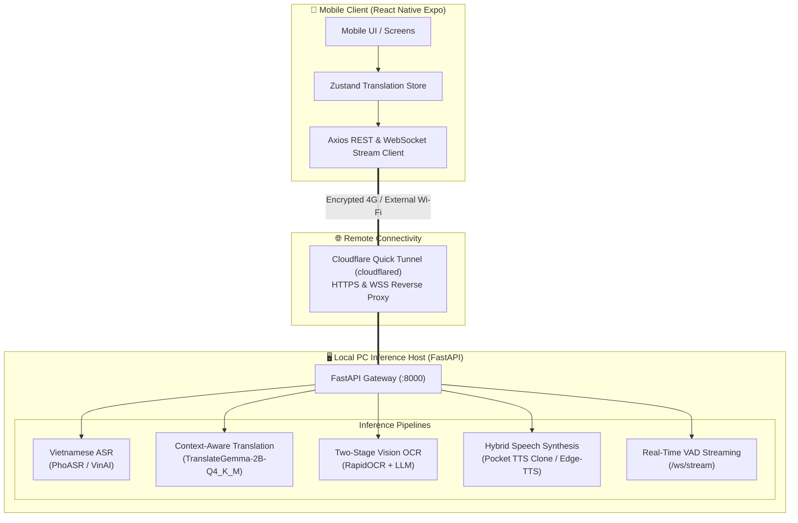

# Context-Aware Multimodal Translation System

An end-to-end AI translation platform featuring Vietnamese speech recognition (PhoASR), two-stage image OCR translation (RapidOCR + TranslateGemma), hybrid TTS speech synthesis with CPU voice cloning (Pocket TTS / Edge-TTS), and real-time streaming WebSockets over an automated Cloudflare Quick Tunnel to a cross-platform mobile app (React Native Expo).

> **Note**: Edge-TTS sends text to Microsoft's cloud service for synthesis. The tunnel connects through Cloudflare's network.

---

## 🏛️ System Architecture



---

## ⚡ Key Highlights

- **Context-Aware Translation**: Steers translations using situational context presets (General, Medical, Technical, Business, Casual) and custom prompts to disambiguate pronouns and domain-specific terminology.
- **VRAM Guardrails**: Efficient multi-model orchestration on consumer GPUs with automatic CPU offloading for TTS and OCR.
- **Hybrid Voice Cloning**: Rapid zero-shot voice cloning with Pocket TTS on CPU using reference audio, plus cloud-based Edge-TTS for additional languages.
- **Zero-Config Remote Connectivity**: Built-in Cloudflare Quick Tunnel automatically exposes the local backend over public HTTPS and WSS, allowing any smartphone on 4G LTE or cellular data to connect instantly.

---

## 🚀 Quick Start Guide

### 1. Prerequisites

- **PC Inference Host**:
  - Python 3.10+ (Tested on Python 3.10 – 3.14)
  - NVIDIA GPU recommended (CUDA 12+, Compute Capability >= 7.5 such as RTX series). Note: GPUs with CC < 7.5 (e.g. Quadro P3200 CC 6.1) will automatically utilize CPU fallback.
- **Mobile Development / Client**:
  - Node.js 18+ and `npm` (Required on the host machine running Expo dev server)
  - Expo Go installed on your iOS or Android mobile phone (available in App Store / Google Play)

---

### 🌟 Interactive Setup Wizard (First-Time Setup)

To configure environment variables, verify local model weights, and set up the Cloudflare Tunnel step-by-step:

```bash
# Run in Git Bash, WSL, or macOS/Linux:
bash setup-wizard.sh
```

---

### 2. PC Host Setup

1. **Clone and navigate to repository**:
   ```bash
   git clone <repo-url>
   cd Translation-App
   ```

2. **Install backend dependencies** (use a virtual environment):
   ```bash
   cd backend
   python -m venv venv
   source venv/bin/activate  # Linux/macOS
   # or: venv\Scripts\activate  # Windows
   pip install -r requirements.txt
   ```

3. **Download models**:
   - PhoASR: `Qualcomm-AI-Research/PhoASR-whisper-small` (auto-downloaded by transformers)
   - TranslateGemma: Download `translategemma-4b-it.Q5_K_M.gguf` and place at `./models/gemma/`
   - Set `GEMMA_GGUF_PATH` in `.env` to point to your model file.

4. **Configure environment variables** (see `.env.example`):
   ```bash
   cp .env.example .env
   # Edit .env with your settings
   ```
   
   **Available settings:**
   - `API_KEY`: Optional. When set, all API routes require `X-API-Key` header.
   - `ALLOW_ONLINE_FALLBACK=false`: Disable online translation fallback.
   - `EDGE_TTS_ENABLED=true`: Enable Edge-TTS for non-Pocket TTS languages.
   - `MAX_AUDIO_DURATION_S=30.0`: Maximum audio duration for ASR.
   - `DEVICE=cuda`: Target device for inference (cuda or cpu).

5. **Run code quality checks and tests**:
   ```bash
   # Run Ruff code quality & lint checks
   python scripts/check.py

   # Run backend tests
   pytest backend/tests/
   ```

---

### 3. Start Backend & Remote Tunnel (One Command)

From the project root or backend folder, launch the unified orchestrator:

```bash
# Recommended: Launches FastAPI server + Cloudflare Tunnel + updates mobile config
python backend/scripts/start_tunnel_and_server.py
```

*Or from the root workspace:*
```bash
python start_app.py
```

**What the launcher does automatically:**
1. Starts the FastAPI Uvicorn backend on port `8000`.
2. Verifies local health at `http://127.0.0.1:8000/health`.
3. Downloads the official `cloudflared` binary if not already present.
4. Spawns an encrypted Cloudflare Quick Tunnel exposing port `8000`.
5. Extracts your public URL (e.g., `https://random-subdomain.trycloudflare.com`).
6. Automatically updates `Translation-App/mobile/src/config/api.ts` with the new tunnel endpoint.

> **Local LAN Only Option:**
> If you prefer testing exclusively within your home Wi-Fi network without the tunnel:
> ```bash
> python backend/scripts/start_tunnel_and_server.py --local-only
> ```

---

### 4. Connect the Mobile App

1. Open a new terminal and navigate to the mobile directory:
   ```bash
   cd Translation-App/mobile
   npm install
   ```

2. Start the Expo development server:
   ```bash
   npx expo start --tunnel
   ```
   *(Or standard `npx expo start` if on the same Wi-Fi network).*

   > **Live microphone streaming** uses the native `react-native-live-audio-stream`
   > PCM module, so it requires a development build (`npx expo run:android` or
   > `npx expo run:ios`). The rest of the app still works in Expo Go.

3. **Scan the QR Code**:
   - **Android**: Open the **Expo Go** app and tap "Scan QR Code".
   - **iOS**: Open the native **Camera** app and tap the Expo link banner.

4. The mobile app will launch and immediately route all translation, voice recognition, image OCR, and voice synthesis requests to your PC host over the public HTTPS tunnel!

---

## 📱 Mobile App Features

| Feature | How It Works | Backend Seam |
| :--- | :--- | :--- |
| **Speech Translation (ASR)** | Hold the microphone button to record Vietnamese speech; PhoASR converts speech into Vietnamese text. | `POST /api/asr` |
| **Camera / Photo Translation** | Take a photo of signs, menus, or documents; RapidOCR extracts text blocks and feeds them into TranslateGemma. | `POST /api/ocr` |
| **Context Steered Translation** | Choose context presets (Medical, Daily, Tech) or type custom context to steer translations. | `POST /api/translate` |
| **Voice Cloning & TTS** | Record a 5-second reference sample to clone your voice for translated audio playback via Pocket TTS. | `POST /api/tts` |
| **Real-Time Streaming** | Live microphone streaming with speech pause detection and progressive token generation. | `WebSocket /ws/stream` |

---

## 📡 API Reference Summary

- `GET /health`: Core health probe reporting device status and allocated GPU VRAM.
- `POST /api/translate`: Context-aware text translation with multi-tier fallback.
- `POST /api/asr`: Vietnamese speech-to-text multipart audio endpoint.
- `POST /api/ocr`: Two-stage image text extraction and contextual translation.
- `POST /api/tts`: Hybrid speech synthesis and CPU voice cloning.
- `WebSocket /ws/stream`: Bi-directional real-time speech and token streaming.

Interactive OpenAPI documentation is live at `http://localhost:8000/docs` (or `<tunnel-url>/docs`).

---

## 🔒 Security & Privacy

- Cloudflare Quick Tunnels provide end-to-end TLS encryption (`HTTPS` / `WSS`) without exposing local router ports or requiring port-forwarding.
- Audio and image files sent for inference are processed in-memory and discarded immediately after prediction.
- Local AI models run entirely on your own host machine.
