# Giải thích toàn bộ dự án Translation-App

> Tài liệu này dành cho **người mới hoàn toàn chưa biết gì về dự án**.
> Đọc xong bạn sẽ hiểu: hệ thống làm gì, gồm những file nào, file nào gọi file nào,
> và mỗi đoạn code quan trọng có tác dụng gì — **nếu xoá đi thì chuyện gì xảy ra**.

---

## Mục lục

1. [Dự án này là gì? (Big picture)](#1-dự-án-này-là-gì)
2. [Sơ đồ kiến trúc tổng thể](#2-sơ-đồ-kiến-trúc-tổng-thể)
3. [Bản đồ file — cái gì nằm ở đâu](#3-bản-đồ-file)
4. [Luồng dữ liệu: 1 request đi qua những file nào](#4-luồng-dữ-liệu)
5. [Backend chi tiết theo từng file](#5-backend-chi-tiết)
6. [Mobile (React Native) chi tiết theo từng file](#6-mobile-chi-tiết)
7. [Scripts, cấu hình, kiểm thử](#7-scripts-cấu-hình-kiểm-thử)
8. [Giải thích "nếu bỏ dòng này thì sao"](#8-nếu-bỏ-thì-sao)
9. [Cách chạy dự án từ số 0](#9-cách-chạy-dự-án)
10. [Câu hỏi thường gặp (FAQ cho người mới)](#10-faq)

---

## 1. Dự án này là gì?

**Translation-App** là một hệ thống **dịch thuật đa phương thức (multimodal) chạy trên máy cá nhân**.

Nói đơn giản: máy tính của bạn (PC) trở thành một **"máy chủ AI"**. Điện thoại của bạn
kết nối tới máy chủ đó và có thể:

| Bạn làm gì trên điện thoại | Hệ thống làm gì |
| :--- | :--- |
| Nói tiếng Việt vào micro | Chuyển giọng nói thành chữ (ASR) |
| Chụp ảnh biển hiệu / menu | Đọc chữ trong ảnh (OCR) rồi dịch |
| Gõ chữ | Dịch sang ngôn ngữ đích |
| Nghe kết quả | Đọc to bản dịch (TTS), thậm chí **nhái giọng bạn** |
| Bật "Live Mic Stream" | Dịch **theo thời gian thực** qua WebSocket |

Điểm đặc biệt: **tất cả AI model chạy trên máy của bạn**, không gửi dữ liệu lên
server bên thứ ba (trừ 2 ngoại lệ có ghi chú rõ: Edge-TTS và Cloudflare Tunnel).

### Bốn "khối AI" chính

| Khối | Model | Chạy ở đâu | Nhiệm vụ |
| :--- | :--- | :--- | :--- |
| **ASR** | PhoASR-whisper-small (Qualcomm) | GPU (hoặc CPU) | Nghe tiếng Việt → ra chữ |
| **Translation** | TranslateGemma-4B (GGUF, Q5_K_M) | GPU/CPU qua llama.cpp | Dịch văn bản, có "ngữ cảnh" |
| **OCR** | RapidOCR (ONNX Runtime) | CPU (0 MB VRAM) | Đọc chữ trong ảnh |
| **TTS** | Pocket TTS + Edge-TTS | CPU / Cloud | Đọc to bản dịch, nhái giọng |

### Điểm nhấn kỹ thuật (điểm "ăn tiền" của đồ án)

1. **Context-Aware Translation** — người dùng chọn "ngữ cảnh" (Trang trọng, Y khoa,
   Kỹ thuật, Du lịch...) để model dịch đúng giọng điệu, đúng thuật ngữ.
2. **VRAM Guardrails** — quản lý bộ nhớ GPU thông minh, đẩy TTS/OCR xuống CPU để
   không làm tràn VRAM.
3. **Hybrid Voice Cloning** — nhái giọng người dùng bằng Pocket TTS trên CPU.
4. **Zero-Config Remote** — Cloudflare Tunnel tự động tạo URL HTTPS công khai để
   điện thoại dùng 4G vẫn kết nối được, **không cần mở port router**.

---

## 2. Sơ đồ kiến trúc tổng thể

### 2.1 Ba tầng của hệ thống

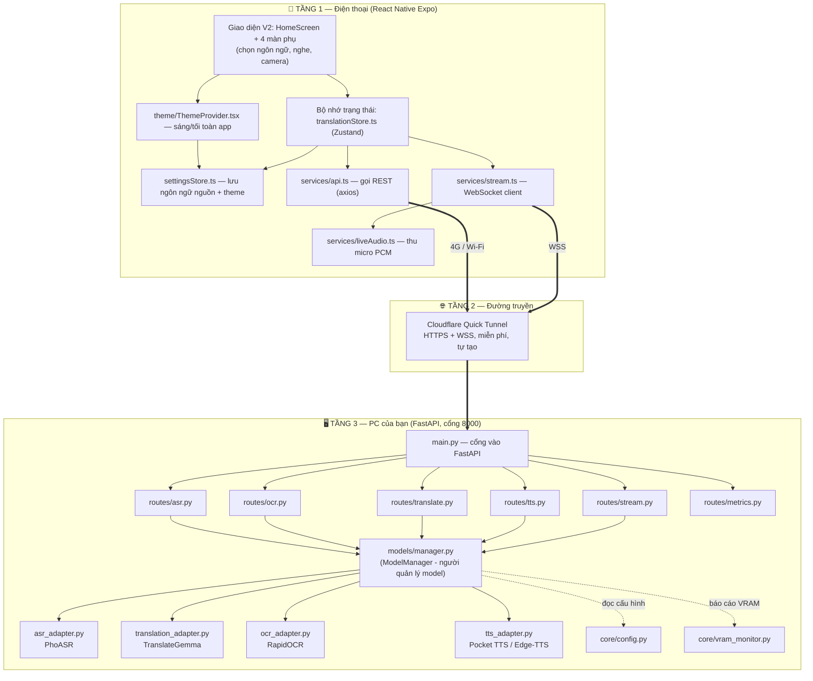

**Cách đọc sơ đồ:** mũi tên `A --> B` nghĩa là "A gọi/ dùng B".
Nét đứt `-.->` nghĩa là "A đọc dữ liệu từ B" (quan hệ phụ thuộc, không phải luồng chính).

### 2.2 Vòng đời một model trong bộ nhớ

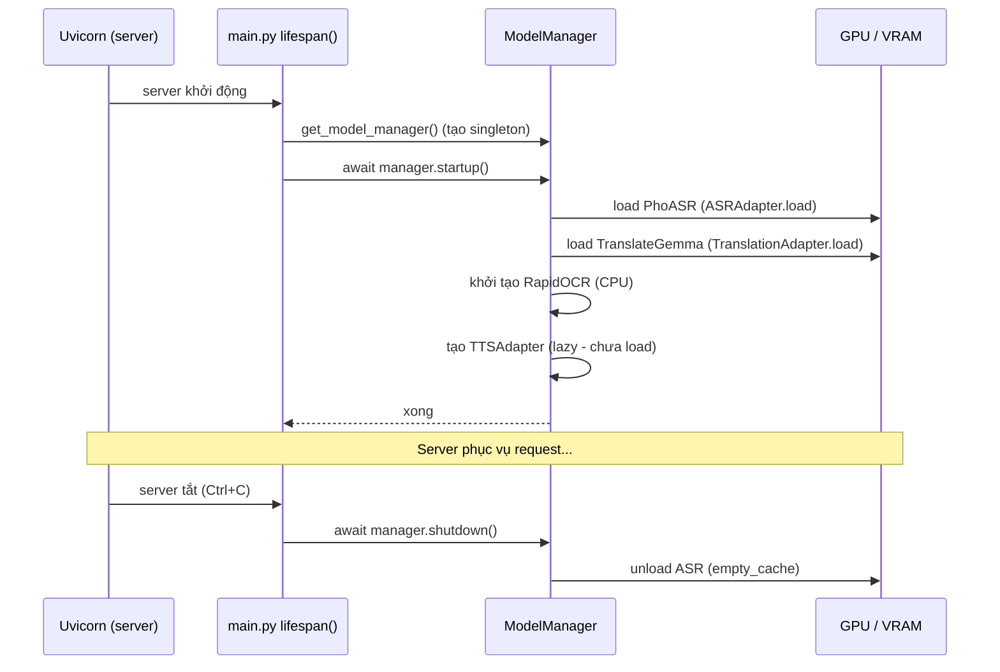

> **Điểm cốt lõi cần nhớ:** model được load **một lần duy nhất** lúc server khởi động,
> rồi giữ trong RAM/VRAM để phục vụ nhiều request. Việc load lại mỗi request sẽ
> cực kỳ chậm (mỗi model 4B mất hàng chục giây).

### 2.3 Bản đồ màn hình Mobile (V2)

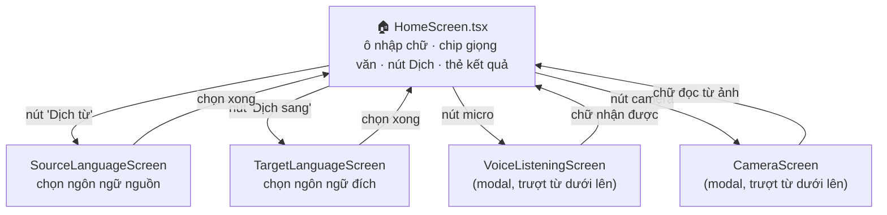

**Đọc sơ đồ:** mọi đường đi đều **bắt đầu và quay về `HomeScreen`**. Các màn phụ chỉ
làm một việc rồi trả kết quả về Home.

> **Khác V1 thế nào?** V1 chỉ có 1 màn hình duy nhất (`TranslationScreen`) với 3 tab
> Text/Voice/Image ngay trong trang. V2 tách thành màn riêng cho từng chức năng, dễ
> kiểm soát giao diện và bố cục hơn.

### 2.4 "Công tắc khả năng" — vì sao UI tự ẩn nút

Điểm đặc trưng của V2: **giao diện thay đổi theo ngôn ngữ đang chọn**. Tất cả dựa vào
3 hàm trong `mobile/src/constants/languages.ts`:

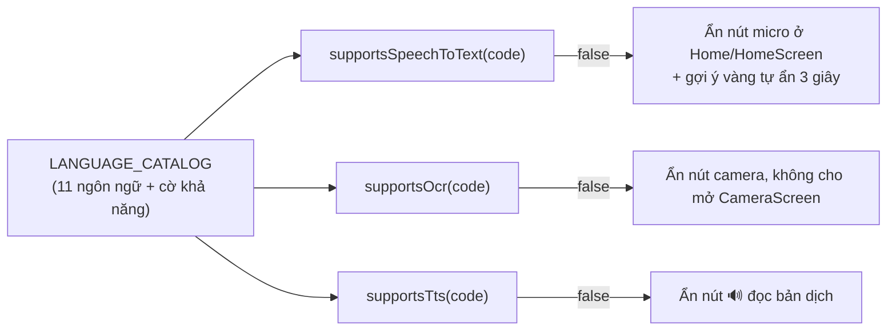

| Khả năng | Ngôn ngữ được bật | Vì sao |
| :--- | :--- | :--- |
| Nghe (STT) | **chỉ `vi`** | PhoASR là model tiếng Việt |
| OCR | `vi`, `en`, `ja`, `zh` | `detect_language()` của OCR chỉ trả 4 mã này |
| Đọc to (TTS) | **cả 11** | TTS có giọng cho mọi ngôn ngữ đích |

- **Nếu bỏ các hàm này:** UI cứ hiện nút, người dùng bấm rồi nhận lỗi từ backend
  (ví dụ micro với nguồn "Japanese") — trải nghiệm kém và khó hiểu.
- Nguồn xác nhận khả năng thật của backend: `docs/language-support.md`.

---

## 3. Bản đồ file

### 3.1 Cây thư mục (chỉ file quan trọng)

```
Translation-App/
├── AGENTS.md                  # Quy tắc cho AI agent & vị trí file
├── CODING_STANDARDS.md        # Tiêu chuẩn code của nhóm
├── README.md                  # Hướng dẫn cài đặt & tổng quan
├── pyproject.toml             # Cấu hình ruff (linter) + pytest
├── setup-wizard.sh            # Script con trỏ về scripts/setup-wizard.sh
├── .gitignore                 # Khai báo file không đưa lên git
│
├── scripts/
│   ├── check.py               # Chạy kiểm tra chất lượng code (ruff)
│   └── setup-wizard.sh        # Wizard cài đặt tương tác 6 bước
│
├── backend/                   # 🖥️ MÁY CHỦ AI (Python)
│   ├── requirements.txt       # Danh sách thư viện Python
│   ├── .env.example           # Mẫu biến môi trường
│   ├── app/
│   │   ├── main.py            # ⭐ Cổng vào ứng dụng FastAPI
│   │   ├── api/
│   │   │   ├── deps.py        # Hàm cung cấp ModelManager cho route
│   │   │   └── routes/
│   │   │       ├── asr.py         # POST /api/asr
│   │   │       ├── ocr.py         # POST /api/ocr
│   │   │       ├── translate.py   # POST /api/translate
│   │   │       ├── tts.py         # POST /api/tts
│   │   │       ├── metrics.py     # GET  /api/metrics
│   │   │       └── stream.py      # ⭐ WS /ws/stream (real-time)
│   │   ├── core/
│   │   │   ├── config.py      # ⭐ Đọc biến môi trường (.env)
│   │   │   └── vram_monitor.py # Đo VRAM + ghi log độ trễ
│   │   ├── models/
│   │   │   ├── manager.py             # ⭐ Quản lý vòng đời model
│   │   │   ├── asr_adapter.py         # Bọc PhoASR
│   │   │   ├── translation_adapter.py # Bọc TranslateGemma
│   │   │   ├── ocr_adapter.py         # Bọc RapidOCR
│   │   │   └── tts_adapter.py         # Bọc Pocket TTS + Edge-TTS
│   │   └── schemas/           # Định nghĩa dữ liệu vào/ra (Pydantic)
│   │       └── asr.py, ocr.py, translate.py, tts.py, health.py
│   ├── scripts/
│   │   ├── start_tunnel_and_server.py  # ⭐ Launcher tổng
│   │   ├── download_models.py          # Tải model
│   │   ├── smoke_test.py               # Kiểm tra server sống/chết
│   │   └── ws_test.py                  # Test WebSocket từ dòng lệnh
│   └── tests/                 # 10 file test tự động
│
└── mobile/                    # 📱 ỨNG DỤNG ĐIỆN THOẠI
    ├── App.tsx                # Điểm vào: nạp font, ThemeProvider, NavigationContainer
    ├── app.json               # Cấu hình Expo (quyền micro/camera...)
    ├── MANUAL_QA.md           # Checklist kiểm tra giao diện V2 bằng tay
    ├── package.json           # Thư viện JS
    └── src/
        ├── config/api.ts      # ⭐ URL server (tự sinh bởi launcher — ĐỪNG sửa tay)
        ├── navigation/
        │   ├── AppNavigator.tsx   # 5 màn hình (Home + 4 màn phụ)
        │   └── types.ts           # Kiểu tham số điều hướng
        ├── screens/           # ⭐ Nơi chứa các màn hình
        │   ├── HomeScreen.tsx         # ⭐ Màn chính kiểu V2
        │   ├── SourceLanguageScreen.tsx  # Chọn "Dịch từ"
        │   ├── TargetLanguageScreen.tsx  # Chọn "Dịch sang"
        │   ├── VoiceListeningScreen.tsx  # Nghe trực tiếp / ghi rồi nhận dạng
        │   └── CameraScreen.tsx          # Chụp/quét ảnh OCR
        ├── store/             # ⭐ Não bộ trạng thái (Zustand)
        │   ├── translationStore.ts   # State dịch thuật + streaming
        │   └── settingsStore.ts      # Cài đặt lưu bền (ngôn ngữ nguồn, theme)
        ├── services/
        │   ├── api.ts         # Gọi REST (axios)
        │   ├── stream.ts      # WebSocket client
        │   └── liveAudio.ts   # Thu PCM từ micro
        ├── hooks/
        │   ├── useSpeech.ts          # Logic đọc to (TTS)
        │   └── useVoiceRecording.ts  # Ghi âm "ghi rồi nhận dạng"
        ├── theme/             # ⭐ Hệ thống giao diện dùng chung
        │   ├── ThemeProvider.tsx  # Bơm màu sáng/tối cho cả app
        │   ├── colors.ts          # Bảng màu light/dark + màu camera
        │   ├── typography.ts      # Cỡ chữ (font Be Vietnam Pro)
        │   └── ThemedText.tsx     # Component chữ tự đổi màu theo theme
        ├── components/        # Component giao diện dùng lại
        │   ├── LanguageTile.tsx / LanguageRow.tsx   # Ô/hàng chọn ngôn ngữ
        │   ├── PrimaryButton / OutlineButton / IconCircleButton
        │   ├── ToneChip / ErrorCard / ScreenHeader / Waveform / CornerFrame
        │   └── (legacy: TranslationScreen.tsx dùng các file V1 cũ — xem §6.10)
        ├── constants/
        │   ├── languages.ts   # ⭐ Nguồn chân lý về ngôn ngữ + khả năng
        │   └── strings.ts     # Toàn bộ chuỗi tiếng Việt
        └── utils/
            ├── scale.ts       # s()/vs()/ms() — co giãn theo màn hình
            └── buildContext.ts # Ghép "giọng văn" + ghi chú thành ngữ cảnh
```

> **Ghi chú về "legacy":** các file `TranslationScreen.tsx`, `LanguagePicker.tsx`,
> `TranslationResult.tsx`, `VoiceRecorder.tsx`, `ImagePickerButton.tsx`,
> `InputModeSelector.tsx`, `ContextInput.tsx`, `VoiceCloningPanel.tsx`,
> `PlaceholderScreen.tsx`, `Card.tsx` là giao diện **V1 cũ**. Chúng được **giữ lại để tham khảo**
> nhưng **không còn được điều hướng tới** (không màn hình V2 nào import). Đầu mỗi file có
> dòng: *"Deprecated: thay bởi giao diện V2. Giữ để tham khảo."*

### 3.2 Bảng tra nhanh "tôi muốn sửa X thì vào đâu?"

| Tôi muốn... | Sửa file |
| :--- | :--- |
| Đổi cổng server, bật API key | `backend/app/core/config.py` hoặc `.env` |
| Đổi model dịch / câu lệnh prompt | `backend/app/models/translation_adapter.py` |
| Thêm ngôn ngữ mới | `mobile/src/constants/languages.ts` + `tts_adapter.py` |
| Đổi ngưỡng nhận biết giọng nói (VAD) | `backend/app/api/routes/stream.py` → class `VADSettings` |
| Đổi giao diện màn hình chính | `mobile/src/screens/HomeScreen.tsx` |
| Đổi màn chọn ngôn ngữ | `mobile/src/screens/SourceLanguageScreen.tsx` / `TargetLanguageScreen.tsx` |
| Đổi màn nghe / camera | `mobile/src/screens/VoiceListeningScreen.tsx` / `CameraScreen.tsx` |
| Đổi màu sắc / chữ cả app | `mobile/src/theme/colors.ts` / `typography.ts` |
| Đổi câu chữ tiếng Việt trong app | `mobile/src/constants/strings.ts` |
| Đổi ngôn ngữ mặc định khi mở app | `mobile/src/constants/languages.ts` (`DEFAULT_SOURCE_CODE`) |
| Thêm endpoint API mới | Tạo file trong `backend/app/api/routes/` rồi đăng ký ở `main.py` |
| Đổi cổng/quyền của app điện thoại | `mobile/app.json` |

---

## 4. Luồng dữ liệu

Phần này là **quan trọng nhất** để hiểu "file này liên kết file kia thế nào".

### 4.1 Luồng 1 — Dịch bằng văn bản (đơn giản nhất, học từ đây)

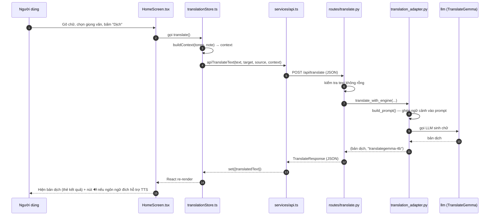

**Chuỗi file:** `HomeScreen.tsx` → `translationStore.ts` → `services/api.ts`
→ (mạng) → `routes/translate.py` → `models/translation_adapter.py` → model.

> **So với V1:** trước đây chỗ `HomeScreen` là `TranslationScreen`, và ngữ cảnh do người
> dùng gõ tay. V2 thay bằng các **chip giọng văn** (Trang trọng / Thân mật / Học thuật /
> Kinh doanh) + ô ghi chú; `utils/buildContext.ts` ghép chúng thành chuỗi `context`.

### 4.2 Luồng 2 — Ghi âm giọng nói rồi dịch (ASR)

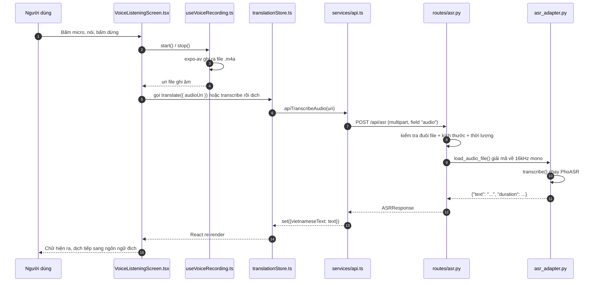

> **Hai chế độ trong `VoiceListeningScreen`:**
> - **Nghe trực tiếp** (chỉ khi có module native + ngôn ngữ nguồn hỗ trợ STT):
>   `services/liveAudio.ts` thu PCM 100 ms/gói và `services/stream.ts` đẩy lên
>   `/ws/stream` — xem §4.4.
> - **Ghi rồi nhận dạng** (mặc định ở Expo Go): dùng `useVoiceRecording` ghi ra file,
>   bấm dừng mới gọi `POST /api/asr`. Chữ chỉ hiện **sau khi dừng**, không realtime.

### 4.3 Luồng 3 — Dịch ảnh (OCR 2 giai đoạn)

```mermaid
flowchart LR
    A["Ảnh chụp / thư viện"] --> B["CameraScreen.tsx<br/>(expo-camera / expo-image-picker)"]
    B --> C["translationStore.processImage(uri, language)"]
    C --> D["POST /api/ocr"]
    D --> E["Giai đoạn 1: RapidOCR<br/>đọc chữ ra khỏi ảnh"]
    E --> F["detect_language()<br/>đoán ngôn ngữ (vi/en/ja/zh)"]
    F --> G["Giai đoạn 2: TranslateGemma<br/>dịch văn bản vừa đọc"]
    G --> H["OCRResponse<br/>extracted_text + translated_text"]
    H --> I["Hiện trên HomeScreen (thẻ kết quả)"]
```

> **"Hai giai đoạn" (two-stage) nghĩa là gì?** Giai đoạn 1 chỉ *đọc chữ* (không hiểu
> nghĩa), giai đoạn 2 mới *hiểu và dịch*. Tách ra như vậy vì mỗi model làm 1 việc giỏi
> hơn là 1 model làm tất cả.

### 4.4 Luồng 4 — Real-time streaming (phức tạp nhất)

Đây là "trái tim" của dự án. Điện thoại gửi **từng gói âm thanh thô** liên tục, server
tự phát hiện khi nào bạn ngừng nói (VAD), rồi dịch và đọc to.

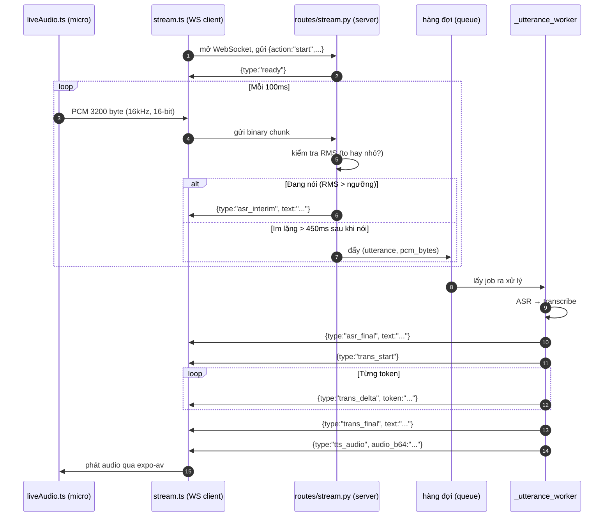

**Ý tưởng thiết kế then chốt: `queue` (hàng đợi) + `worker` (người xử lý).**
Vòng lặp nhận âm thanh (`while True: receive`) **không bao giờ bị chặn** — nó chỉ đẩy
việc vào hàng đợi rồi tiếp tục nghe. Một "worker" chạy song song lấy việc ra làm.
Nếu không có hàng đợi, khi model đang dịch câu 1 thì server không nghe được câu 2 →
âm thanh bị mất.

---

## 5. Backend chi tiết

### 5.1 `backend/app/core/config.py` — Nơi khai báo mọi thứ có thể tinh chỉnh

**Nhiệm vụ:** đọc file `.env` (nếu có) và biến môi trường, gom thành 1 object `settings`
dùng chung toàn backend.

```python
class Settings(BaseSettings):
    MODELS_DIR: str = "./models"                                  # thư mục chứa model
    PHOASR_MODEL_ID: str = "Qualcomm-AI-Research/PhoASR-whisper-small"
    GEMMA_GGUF_PATH: str = "./models/gemma/translategemma-4b-it.Q5_K_M.gguf"
    DEVICE: str = "cuda"                       # "cuda" hoặc "cpu"
    GEMMA_N_CTX: int = 4096                    # cửa sổ ngữ cảnh của LLM
    GEMMA_N_GPU_LAYERS: int = -1               # -1 = đẩy hết layer lên GPU
    MAX_AUDIO_DURATION_S: float = 30.0         # chặn file audio quá dài
    ALLOW_ONLINE_FALLBACK: bool = False        # cho phép fallback online không
    EDGE_TTS_ENABLED: bool = True              # bật/tắt Edge-TTS
    API_PREFIX: str = "/api"                   # tiền tố mọi route
    HOST: str = "0.0.0.0"                      # 0.0.0.0 = lắng nghe mọi card mạng
    PORT: int = 8000
    API_KEY: str | None = None                 # nếu đặt thì phải gửi X-API-Key
```

**Hàm `effective_device()` — tại sao cần nó?**

```python
@lru_cache(maxsize=1)
def _resolve_effective_device(device_setting: str) -> str:
    if device_setting.startswith("cuda"):
        if not torch.cuda.is_available():
            return "cpu"                       # không có CUDA → CPU
        try:
            t = torch.tensor([1.0], device=f"cuda:{device_index}")
            _ = t * 2                          # thử chạy 1 phép tính thật
            return device_setting
        except Exception:
            return "cpu"                       # GPU quá cũ (CC < 7.5) → CPU
    return device_setting
```

- **Ý nghĩa:** chỉ khai báo `DEVICE=cuda` là **không đủ tin cậy**. Có GPU vẫn có thể
  crash nếu card quá cũ (ví dụ Quadro P3200, Compute Capability 6.1 — PyTorch build
  mới không hỗ trợ). Hàm này **chạy thử 1 phép tính thật** để chắc chắn.
- **`@lru_cache(maxsize=1)`**: kết quả được nhớ lại. Vì việc test GPU tốn thời gian,
  và nó chỉ cần chạy 1 lần.
- **Nếu bỏ hàm này:** app sẽ "tưởng" mình dùng được GPU, tới lúc chạy inference thật
  mới crash với lỗi khó hiểu kiểu `CUDA error: no kernel image is available`.

> ⚠️ **Lưu ý phiên bản:** `requirements.txt` ghim `torch==2.15.0`, `transformers==5.22.2`,
> `pydantic==2.14.3`, v.v. Các số này rất cao so với thực tế hiện nay — nhiều khả năng
> là phiên bản "tương lai"/giả định trong bối cảnh đồ án. Khi cài thật, nếu pip báo
> không tìm thấy phiên bản, hãy bỏ số phiên bản để cài bản mới nhất tương thích.

### 5.2 `backend/app/core/vram_monitor.py` — Đo bộ nhớ GPU & độ trễ

Gồm 2 phần:

**a) `get_vram_info()`** — hỏi PyTorch xem VRAM đang dùng bao nhiêu.

```python
reserved_bytes  = torch.cuda.memory_reserved(device)   # allocator đã "giữ chỗ"
allocated_bytes = torch.cuda.memory_allocated(device)  # tensor thực sự đang chiếm
```
- **Phân biệt quan trọng:** `allocated` = bộ nhớ đang bị tensor chiếm; `reserved` =
  bộ nhớ PyTorch đã xin từ driver (bao gồm cả phần cache chưa dùng). Báo cáo cả hai để
  người dùng biết "vì sao `nvidia-smi` thấy VRAM đầy mà model lại nhỏ".
- Nếu không có CUDA → trả về toàn số 0 để app không crash.

**b) `VRAMTracker`** — cuốn sổ ghi lại số liệu đo được.

| Hàm | Ghi lại gì |
| :--- | :--- |
| `record_cold_start(model, ms)` | Thời gian **load model lần đầu** (chậm) |
| `record_warm_inference(model, ms)` | Thời gian **suy luận khi model đã sẵn** (nhanh) |
| `snapshot_vram(label)` | Chụp lại mức VRAM tại 1 thời điểm |
| `get_metrics()` | Trả về min/max/avg/count của mọi số liệu |

Cuối file có `vram_tracker = VRAMTracker()` — một **singleton toàn cục**. Mọi route
import nó để ghi số liệu; `routes/metrics.py` đọc nó ra để trả JSON.

**Nếu bỏ `vram_monitor.py`:** app vẫn chạy, nhưng mất khả năng quan sát hiệu năng và
`GET /api/metrics` sẽ lỗi import. Đây là file "chẩn đoán", không nằm trên đường tới hạn.

### 5.3 `backend/app/models/manager.py` — Nhạc trưởng quản lý model

Đây là file **quan trọng bậc nhất** của backend. Nó giữ 4 adapter và quyết định
cái nào load khi nào.

```python
class ModelManager:
    def __init__(self):
        self.device = settings.effective_device()
        self._asr = None          # ASRAdapter | None
        self._translation = None  # TranslationAdapter | None
        self._ocr = None          # OCRAdapter | None
        self._tts = None          # TTSAdapter | None
        self._is_started = False
        self._startup_errors = {} # lưu lỗi để báo cho client
```

**`startup()` — load model, có "bẫy lỗi" từng cái:**

```python
try:
    self._asr = ASRAdapter(device=self.device)
    loop = asyncio.get_event_loop()
    await loop.run_in_executor(None, self._asr.load)   # ← chạy ở thread riêng
except Exception as e:
    self._startup_errors["asr"] = str(e)
    self._asr = None
```

Hai chi tiết đắt giá:

1. **`run_in_executor(None, ...)`** — `self._asr.load` là code **đồng bộ, chặn (blocking)**,
   mất hàng chục giây. Nếu gọi thẳng trong hàm `async`, nó sẽ **đóng băng toàn bộ server**
   (không nhận được request nào khác). `run_in_executor` đẩy nó sang một luồng riêng.
2. **`try/except` từng model riêng biệt** — nếu PhoASR lỗi, TranslateGemma/OCR/TTS vẫn
   được thử load. Nhờ vậy app **suy giảm một phần** thay vì chết hẳn. Lỗi được lưu vào
   `_startup_errors` để `/health` và `/api/metrics` báo cho người dùng biết model nào hỏng.

**`get_status()` — báo cáo model nào đang sống:**

```python
"asr": self._asr is not None and self._asr._pipe is not None,
"translation": self._translation is not None and self._translation._llm is not None,
```
- Kiểm tra **cả object lẫn thuộc tính bên trong**. Vì adapter có thể tồn tại nhưng
  model thật chưa load xong (`_pipe`/`_llm` vẫn `None`). Báo sai ở đây sẽ khiến
  người dùng tưởng hệ thống chạy được trong khi thực tế không.

**`get_model_manager()` — singleton:**

```python
_manager_instance: ModelManager | None = None

def get_model_manager() -> ModelManager:
    global _manager_instance
    if _manager_instance is None:
        _manager_instance = ModelManager()
    return _manager_instance
```
- **Tại sao phải singleton?** Model 4B chỉ nên tồn tại **một bản trong bộ nhớ**. Nếu mỗi
  request tạo một `ModelManager` mới, máy sẽ cạn RAM/VRAM sau vài request.
- **Nếu bỏ singleton:** mỗi lần gọi API sẽ load lại model → treo máy.

### 5.4 `backend/app/models/asr_adapter.py` — Bọc PhoASR

**Hàm độc lập `load_audio_file()`** — "cửa ngửi" mọi âm thanh đi vào hệ thống:

```python
def load_audio_file(audio_path, target_sr=16000) -> tuple[np.ndarray, float]:
    # 1. Thử giải mã bằng PyAV (hỗ trợ m4a/mp3/webm — định dạng điện thoại ghi)
    # 2. Thất bại → fallback sang soundfile (wav/flac/ogg)
    # 3. Resample về 16 kHz bằng soxr (nếu có), librosa, hoặc np.interp
    # 4. Chuyển stereo → mono (data.mean(axis=1))
    # 5. Nếu âm lượng max < 1e-4 → raise "Audio is silent"
    # 6. Trả về (mẫu âm thanh, thời lượng giây)
```

Từng bước giải thích:
- **Tại sao 16 kHz?** Whisper-family model được huấn luyện trên âm thanh 16 kHz.
  Điện thoại ghi 44.1/48 kHz — phải đổi tần số mẫu, không thì model "nghe kỳ kỳ".
- **Tại sao PyAV trước?** Điện thoại (iOS/Android) ghi ra **.m4a** — soundfile
  không giải mã được định dạng này. PyAV (FFmpeg) giải mã được.
- **Ba tầng fallback resample** (soxr → librosa → np.interp): nếu thiếu thư viện
  nhanh nhất thì dùng thư viện chậm hơn thay vì chết hẳn. Chuẩn hoá stereo→mono vì
  model chỉ nhận 1 kênh.
- **Nếu bỏ kiểm tra "silent":** âm thanh im lặng sẽ được đưa vào Whisper, kết quả là
  chuỗi rác/ hallucination (model tự bịa chữ) — rất khó debug.

**Class `ASRAdapter`:**

```python
def load(self):
    if self.device.startswith("cuda"):
        device_arg = int(...) if có index else 0   # "cuda:1" → 1
    else:
        device_arg = -1                            # -1 = CPU
    self._pipe = pipeline("automatic-speech-recognition",
                          model=self.model_id, device=device_arg)
```
- Dùng `transformers.pipeline` — API cao cấp, tự lo tokenization/post-processing.
- `device=-1` là quy ước của transformers cho CPU.

```python
def transcribe(self, audio_path):
    self.load()                                    # lazy load nếu chưa có
    data, duration = load_audio_file(audio_path, target_sr=16000)
    generate_kwargs = {"task": "transcribe", "language": "vi"}
    with self._lock:                               # ← CHỐT: chỉ 1 luồng chạy 1 lúc
        res = self._pipe(data, generate_kwargs=generate_kwargs)
```

**`self._lock` là điểm thiết kế cốt lõi.** GPU không xử lý được 2 suy luận đồng thời
trên cùng 1 model — chạy song song sẽ tràn VRAM hoặc hỏng kết quả. `threading.Lock`
ép các request xếp hàng. Nhờ đó request thứ 2 chỉ là *chờ*, không phải *lỗi*.
Nếu bỏ lock: 2 người nói cùng lúc → app sập hoặc trả kết quả sai lệch.

Test `test_inference_serialization.py` tồn tại **duy nhất để bảo vệ lock này**.

### 5.5 `backend/app/models/translation_adapter.py` — Bọc TranslateGemma

**a) Bảng preset ngữ cảnh** — "linh hồn" của tính năng Context-Aware:

```python
CONTEXT_PRESETS = {
    "Formal":   "Văn phong lịch sự, chuẩn mực kinh doanh...",
    "Friendly": "Văn phong tự nhiên, thân thiện...",
    "IT":       "Bối cảnh công nghệ thông tin... Giữ nguyên thuật ngữ (API, Deploy...)",
    "Medical":  "Văn phong học thuật, chính xác tuyệt đối về thuật ngữ y khoa...",
    "Travel":   "Diễn đạt ngắn gọn, thực tế cho sân bay, khách sạn, nhà hàng...",
    "General":  "Dịch tự nhiên, trung tính...",
}
```
- Đây là **câu lệnh tiếng Việt** được ghép vào prompt gửi cho LLM. Model hiểu tiếng Việt
  nên việc viết prompt bằng tiếng Việt là hợp lý.
- **Nếu bỏ bảng này:** mọi bản dịch dùng 1 giọng điệu duy nhất; mất tính năng
  "dịch đúng ngữ cảnh" — tính năng tiêu đề của đồ án.

**b) `build_prompt()` —ghép các mảnh thành lời nhắc hoàn chỉnh:**

```python
return (
    f"<start_of_turn>user\n"
    f"You are a professional {src_name} to {tgt_name} translator. ..."
    f"Context requirement: {combined_context}.\n"
    f"Produce only the {tgt_name} translation, without any additional explanations.\n\n"
    f"{text}<end_of_turn>\n"
    f"<start_of_turn>model\n"
)
```
- `<start_of_turn>` / `<end_of_turn>` là **định dạng chat template chính thức của Gemma**.
  Sai định dạng → model trả lời lung tung hoặc lặp vô hạn.
- Dòng "Produce only the translation" chống việc model thêm lời bình luận thừa.
- **Nếu bỏ `Context requirement`:** bản dịch vẫn chạy nhưng "triệt tiếc" — câu nói
  suồng sã với bạn bè sẽ bị dịch như văn bản pháp lý.

**c) Logic chọn preset trong `build_prompt`:**

```python
if preset_candidate:                      # client gửi context_preset="Medical"
    tìm trong CONTEXT_PRESETS theo key
elif context:                             # fallback: client gửi "context" kiểu cũ
    tìm preset có tên nằm trong chuỗi context
```
Điểm này giữ **tương thích ngược**: app cũ chỉ gửi `context`, app mới gửi
`context_preset` — cả hai đều hoạt động.

**d) `translate()` — lời gọi suy luận:**

```python
with self._lock:
    output = self._llm(prompt, max_tokens=512, temperature=0.3, top_p=0.9,
                       stop=["<end_of_turn>", "\n\nUser:"])
```
- `temperature=0.3` — **thấp có chủ đích**. Dịch cần **ổn định và chính xác**, không
  cần sáng tạo. Giá trị cao (1.0) làm bản dịch "phóng tác".
- `stop=[...]` — dừng sinh khi gặp token kết thúc lượt, chống model tự thoại tiếp.
- `max_tokens=512` — trần độ dài đầu ra, phòng model bị kẹt lặp.

**e) `translate_stream()` — dịch theo từng token (cho real-time):**

```python
for chunk in self._llm(prompt, ..., stream=True):
    yield token          # generator: nhả từng mảnh chữ ra
```
- Là **Python generator** — server route sẽ đọc từng token và đẩy ngay qua WebSocket.
  Người dùng thấy chữ hiện dần thay vì chờ cả câu.
- **Chi tiết tinh tế:** lock được `acquire()` tay, `finally: release()` — vì generator
  bị "tiêu" dần ở nhiều thời điểm, dùng `with` sẽ giải phóng lock quá sớm.
- **Nếu stream lỗi** → fallback xuống `translate()` thường, nhả nguyên cả câu 1 lần.

**f) `_resolve_model_path()` — tìm file model ở nhiều nơi:**

```python
candidates = [
    Path(settings.GEMMA_GGUF_PATH),            # theo .env (chuẩn)
    Path("d:/APP test/models/gemma/..."),      # đường dẫn cứng của 1 máy cụ thể
    Path("./models/gemma/..."),
    Path("/content/models/gemma/..."),         # Google Colab
]
```
- Có dòng hardcode `d:/APP test/...` — **code sửa nhanh thời dev, nên dọn**. Nhưng
  về bản chất nó là mạng lưới an toàn: tìm được file ở đâu thì dùng ở đó.
- **Nếu bỏ hàm này:** chỉ tìm được model theo đúng 1 path trong `.env`; path khác
  → lỗi "model not loaded".

### 5.6 `backend/app/models/ocr_adapter.py` — Bọc RapidOCR

```python
def detect_language(text: str) -> str:
    vi_chars = set("àáảãạă...đ")          # 1. Ký tự đặc trưng tiếng Việt
    if any(c in vi_chars for c in lower):  return "vi"
    for char in text:
        if 0x3040 <= cp <= 0x309F or ...:  # 2. Hiragana/Katakana
            return "ja"
        if 0x4E00 <= cp <= 0x9FFF:         # 3. CJK chữ Hán
            return "zh"
    return "en"                            # 4. Mặc định
```
- **Thuật toán: tra bảng mã Unicode + từ điển ký tự.** Rẻ (0 ms), không cần model,
  và đủ chính xác cho 4 ngôn ngữ chính. Đây là **heuristic** — không phải AI.
- **Thứ tự kiểm tra có chủ đích:** tiếng Việt trước (vì tiếng Việt dùng ký tự Latin
  có dấu), tiếng Nhật trước tiếng Trung (katakana/hiragana chỉ có ở Nhật; chữ Hán
  dùng chung với Trung) — đảo thứ tự là tiếng Nhật sẽ bị đoán thành Trung.
- **Nếu bỏ:** không biết ảnh chứa tiếng gì → không biết dịch sang ngôn ngữ nào.

```python
def extract_text(self, image_input):
    # bytes → ghi file tạm .png → RapidOCR chạy → xoá file tạm
    with self._lock:
        result, _ = self._engine(img_path)
    lines = [item[1] for item in result]   # chữ
    boxes = [item[0] for item in result]   # toạ độ khung chữ
    full_text = " ".join(lines).strip()
    lang = detect_language(full_text)
```
- RapidOCR chạy **trên CPU** (ONNX Runtime) — chiến lược chủ đạo của đồ án:
  GPU dành cho LLM, CPU đảm nhận OCR để không cạn VRAM.
- File tạm `delete=False` + xoá trong `finally` — đảm bảo dù lỗi vẫn dọn dẹp
  (đúng chuẩn CODING_STANDARDS.md mục E).

### 5.7 `backend/app/models/tts_adapter.py` — TTS lai (phức tạp nhất trong adapters)

**Hai engine, hai vai trò:**

| Engine | Chạy ở đâu | Dùng khi nào |
| :--- | :--- | :--- |
| **Pocket TTS** | CPU (local) | Nhái giọng từ audio mẫu, ngôn ngữ en/fr/de/es/pt/it/nl |
| **Edge-TTS** | Cloud Microsoft | Tiếng Việt (không clone được), hoặc không có audio mẫu |

**Bảng giọng Edge-TTS:** `EDGE_VOICES_FEMALE` / `EDGE_VOICES_MALE` map mã ngôn ngữ →
tên giọng cụ thể (`"vi": "vi-VN-HoaiMyNeural"`...). Giọng nam áp dụng khi
`voice_style="male"`.

**Hàm trung tâm `synthesize()` — cây quyết định:**

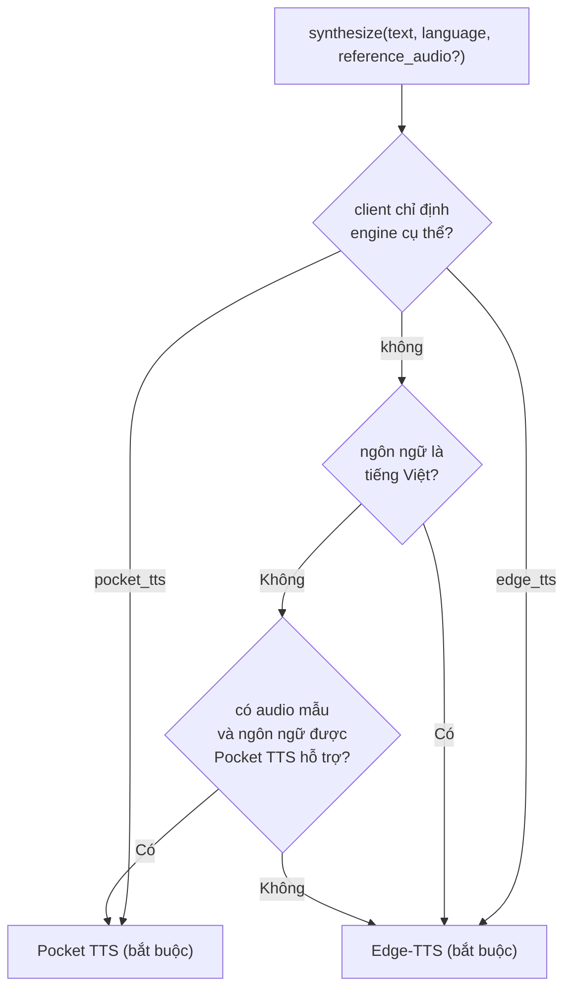

> **Tại sao tiếng Việt luôn đi Edge-TTS?** Pocket TTS không có checkpoint tiếng Việt.
> Đây là **sự đánh đổi công khai**: để clone giọng tiếng Việt cần model local hỗ trợ —
> hiện chưa có, nên dùng cloud. Nhược điểm được ghi rõ trong README (dữ liệu đi qua
> server Microsoft).

**Chi tiết đáng chú ý trong code:**

```python
def _load_pocket_tts(self, language):
    with lock:                                   # per-language lock
        if canonical_lang not in self._pocket_models:
            model = TTSModel.load_model(language=canonical_lang)
            self._pocket_models[canonical_lang] = model
```
- **Double-checked locking** (kiểm tra trước + sau khi giữ lock) — pattern chuẩn để
  tránh 2 thread cùng load 1 model 2 lần.
- `self._pocket_models[canonical_lang] = None` khi lỗi — ghi nhận **đã thử và thất bại**,
  tránh thử lại vô hạn mỗi request.

```python
class TTSResult(tuple):
    def __new__(cls, audio, sample_rate, engine="edge_tts", voice_note=""):
        obj = super().__new__(cls, (audio, sample_rate))
        obj.engine = engine          # gắn thuộc tính phụ lên tuple
```
- Là tuple `(audio, sample_rate)` **nhưng có thêm `.engine`, `.voice_note`**. Nhờ đó
  code cũ xử lý như tuple vẫn chạy, code mới đọc được metadata. Tương thích 2 thế hệ
  client trong 1 class.

**Nếu bỏ file này:** tính năng "nghe bản dịch" mất hoàn toàn — chỉ còn chữ trên màn hình.

### 5.8 `backend/app/api/deps.py` — Cầu nối nhỏ nhưng thiết yếu

```python
def dep_model_manager() -> ModelManager:
    return get_model_manager()
```

11 dòng duy nhất. Tại sao tồn tại? Vì trong FastAPI, để route nhận được ModelManager
ta viết:

```python
manager: ModelManager = Depends(dep_model_manager)
```

- **Lợi ích:** test có thể "vá" dependency này để đưa model giả vào, không cần chạy
  model thật (xem `test_stream_websocket.py`). Nếu mỗi route tự gọi
  `get_model_manager()` trực tiếp, việc test sẽ khó hơn nhiều.
- **Nếu bỏ:** mỗi route phải import manager thủ công; hệ thống test phá vỡ.

### 5.9 `backend/app/schemas/` — "Hợp đồng" dữ liệu vào/ra

Mỗi file định nghĩa 1 lớp Pydantic — mô tả **chính xác** JSON mà client gửi/nhận.

| File | Định nghĩa | Vai trò |
| :--- | :--- | :--- |
| `translate.py` | `TranslateRequest` + `TranslateResponse` | Body cho POST /api/translate |
| `asr.py` | `ASRResponse` | JSON trả về từ POST /api/asr |
| `ocr.py` | `OCRResponse` | JSON trả về từ POST /api/ocr |
| `tts.py` | `TTSRequest` + `TTSResponse` | Body + trả về của POST /api/tts |
| `health.py` | `VRAMInfo` + `HealthResponse` | JSON của GET /health |

Điểm đáng chú ý:

```python
# translate.py
@field_validator("text", "target_language")
def validate_non_whitespace(cls, v: str) -> str:
    if not v or not v.strip():
        raise ValueError("Field must not be empty or whitespace only.")
    return v.strip()
```
- **Chặn sớm ở cửa**: text toàn khoảng trắng bị loại ngay, không tốn công gọi LLM.
- Tự động trả HTTP 422 cho client, route không cần code thêm.

```python
# ocr.py
vietnamese_text: str = Field(..., description="Legacy field ... mobile compatibility")
```
- Trường "di sản": app điện thoại phiên bản đầu đọc `vietnamese_text`. Giữ nó để
  mobile cũ không vỡ khi backend nâng cấp. **Nếu bỏ:** app mobile phải build lại.

### 5.10 `backend/app/main.py` — Cổng vào

**`lifespan` — khởi động/tắt an toàn:**

```python
@asynccontextmanager
async def lifespan(app):
    manager = get_model_manager()
    try:
        import av              # kiểm tra PyAV — cảnh báo nếu thiếu
    except ImportError:
        logger.warning("PyAV is not installed...")
    await manager.startup()    # ← load model (có thể mất 30-60 giây)
    yield                      # ← server chạy ở đây
    await manager.shutdown()   # ← dọn dẹp khi tắt
```
- `yield` là ranh giới "app đang sống". Mọi thứ trước yield là khởi động, sau là dọn dẹp.
- **Nếu bỏ `await manager.startup()`:** server sống nhưng mọi request đều báo
  "model not loaded".

**API Key middleware — khoá cổng (tuỳ chọn):**

```python
@application.middleware("http")
async def api_key_middleware(request, call_next):
    if settings.API_KEY:                                   # chỉ bật khi đã đặt key
        if request.url.path not in ("/health", "/docs", ...):
            api_key = request.headers.get("X-API-Key") or ...
            if api_key != settings.API_KEY:
                return JSONResponse(status_code=401, ...)
    return await call_next(request)
```
- Vì server nằm trên Internet công khai (qua tunnel), ai cũng gọi được. Middleware
  này là **lớp bảo vệ duy nhất** khi triển khai thật.
- `/health`, `/docs` được miễn — để tunnel launcher dùng `/health` dò server sống.
- **Nếu bỏ:** server mở cửa cho cả thế giới, ai biết URL cũng dùng máy GPU của bạn.

**CORS middleware:** cho phép mọi origin (`allow_origins=["*"]`). Cần cho dev; khi
lên production nên siết lại thành URL cụ thể.

**Đăng ký router + `/health`:**

```python
prefix = settings.API_PREFIX          # "/api"
application.include_router(asr.router, prefix=prefix)
application.include_router(ocr.router, prefix=prefix)
application.include_router(translate.router, prefix=prefix)
application.include_router(tts.router, prefix=prefix)
application.include_router(metrics.router, prefix=prefix)
application.include_router(stream.router)   # ← KHÔNG prefix: /ws/stream là đường gốc
```
- Chú ý `stream` không có prefix — WebSocket dùng `/ws/stream` ở gốc, hợp với client.

### 5.11 `backend/app/api/routes/` — Sáu cánh cửa

#### `routes/translate.py` (75 dòng — ngắn nhất, đọc đầu tiên để học pattern)

```python
@router.post("", response_model=TranslateResponse)
async def translate_text(body: TranslateRequest,
                         manager: ModelManager = Depends(dep_model_manager)):
    if not body.text or not body.text.strip():
        raise HTTPException(422, "'text' must not be empty.")
    translated, engine = await asyncio.get_event_loop().run_in_executor(
        None, lambda: translation_adapter.translate_with_engine(...))
    vram_tracker.record_warm_inference("gemma", elapsed_ms)
    return TranslateResponse(translated_text=translated, ...)
```

Ba pattern lặp lại ở mọi route, cần hiểu rõ:
1. **`run_in_executor`** — suy luận là code chặn; đẩy sang thread để event loop
   (và WebSocket) không bị đóng băng. Route sync bằng cách này mới phục vụ được
   nhiều client.
2. **`vram_tracker.record_warm_inference(...)`** — ghi số liệu để `/api/metrics`.
3. **Bắt lỗi theo tầng:** `HTTPException` → ném lại nguyên vẹn; `RuntimeError` → 503
   ("dịch vụ đang bận/hỏng"); còn lại → 500 + log đầy đủ.

#### `routes/asr.py` (151 dòng)

Tầng bảo vệ dày nhất, vì đầu vào là file nhị phân từ mạng:

| Kiểm tra | Mã lỗi | Ngăn chặn |
| :--- | :--- | :--- |
| Đuôi file thuộc `{.wav,.mp3,.m4a,.flac,.ogg,.webm}` | 415 | File lạ |
| Tổng kích thước ≤ 100 MB (đọc theo chunk) | 413 | Tấn công làm đầy RAM/disk |
| File > 100 byte | 422 | File rỗng |
| Thời lượng ≤ `MAX_AUDIO_DURATION_S` | 422 | Treo GPU 30 phút |
| Nội dung giải mã được (không im lặng) | 422 | Phí model chạy vô ích |

**Đọc theo chunk 64 KB** (`while chunk := await audio.read(65_536)`) thay vì
`await audio.read()` — nếu đọc một phát, file 100 MB sẽ chiếm trọn 100 MB RAM.
Đây là kỹ thuật **streaming upload** chuẩn.

Kết thúc: file tạm xoá trong `finally` — không rò rỉ đĩa cứng kể cả khi lỗi.

#### `routes/ocr.py` (156 dòng)

Tương tự ASR nhưng cho ảnh (20 MB giới hạn, đuôi `.png/.jpg/...`), cộng thêm
**giai đoạn 2 — tự quyết định ngôn ngữ:**

```python
resolved_target = (target_language or "").strip()
if not resolved_target:
    resolved_target = "en" if detected_lang.lower() == "vi" else "vi"
```
- Người dùng không chọn ngôn ngữ đích? Server tự đoán: ảnh tiếng Việt → dịch sang
  tiếng Anh; ảnh ngoại ngữ → dịch sang tiếng Việt. Trải nghiệm "chụp là hiểu".
- `vietnamese_text` ở cuối response giữ tương thích với mobile.

#### `routes/tts.py` (191 dòng)

Đặc biệt: chấp nhận **hai định dạng request**:

```python
if content_type.startswith("application/json"):
    parsed = TTSRequest.model_validate(body)     # JSON → dùng schemas/tts.py
    text, language, ... = parsed.text, parsed.language, ...
```
- Form multipart (khi có file audio mẫu) **hoặc** JSON (khi chỉ gửi text). Một
  endpoint phục vụ cả hai cách gọi — client linh hoạt.
- Audio trả về dạng **base64 trong JSON** (không phải file nhị phân) — tiện cho
  client JS decode rồi ghi file phát lại.

#### `routes/metrics.py` (28 dòng)

```python
return {"model_status": manager.get_status(), "latency_metrics": vram_tracker.get_metrics()}
```
Chỉ gom 2 nguồn số liệu thành 1 JSON. Dùng để theo dõi hiệu năng/VRAM khi demo.

#### `routes/stream.py` (550 dòng — phức tạp nhất, "trái tim real-time")

**Cấu trúc tổng thể:**

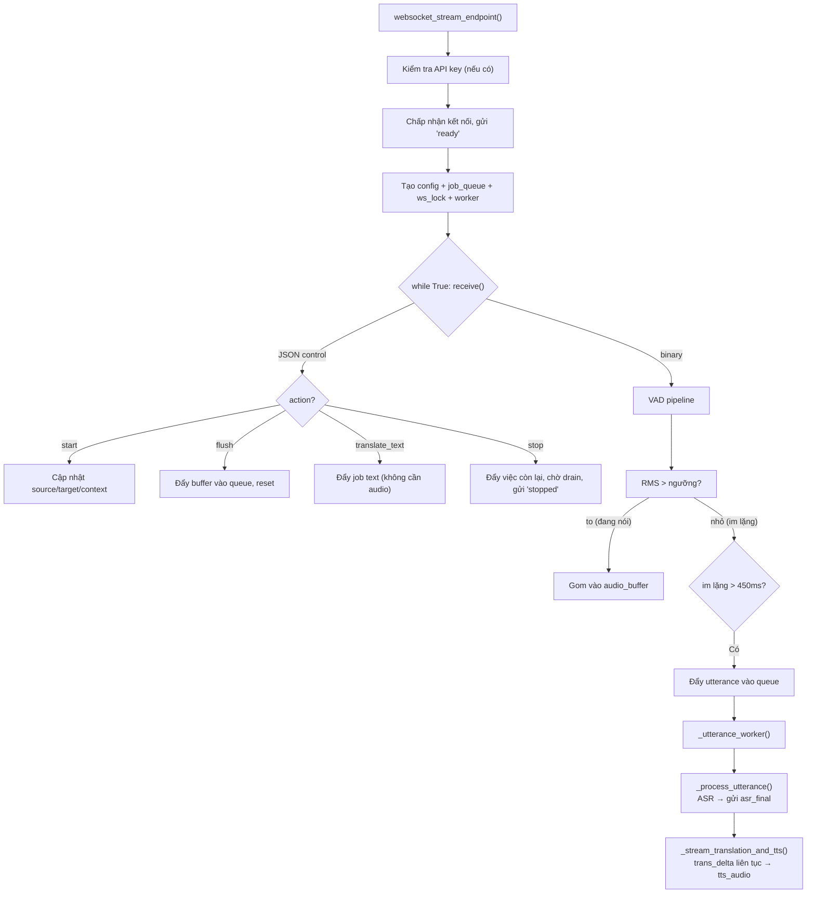

**Các mảnh ghép đáng học:**

**1) `VADSettings` — cấu hình tập trung, không con số ma thuật:**
```python
class VADSettings:
    min_speech_bytes: int = 3200       # 100ms audio @16kHz 16-bit
    rms_threshold: float = 0.012       # ngưỡng "có tiếng người" (0-1)
    silence_duration_s: float = 0.45   # ngừng nói > 450ms = hết câu
    min_speech_samples: int = 4800     # ít nhất 300ms mới đáng xử lý
```
Đây là yêu cầu bắt buộc trong CODING_STANDARDS.md (mục B — "no magic numbers").
Nếu bỏ class này, các con số rải rác trong code, sửa 1 chỗ quên 5 chỗ khác.

**2) `ring_buffer` — giữ 300ms âm thanh TRƯỚC khi bạn bắt đầu nói:**
```python
ring_buffer.append(raw_chunk)              # chưa nói → giữ lại
while ring_buffer_size > _ring_bytes:      # chỉ giữ đoạn gần nhất
    evicted = ring_buffer.popleft()
...
for chunk in ring_buffer:                  # khi vừa phát hiện bắt đầu nói
    audio_buffer.extend(chunk)             # ném cả 300ms trước đó vào
```
- **Vấn đề nó giải quyết:** RMS có độ trễ — tới khi vượt ngưỡng, vài chục ms âm đầu
  câu đã trôi qua. Không có ring buffer, âm tiết đầu bị mất → ASR nhận sai chữ đầu.
- **Nếu bỏ:** bản dịch thường sai chữ đầu tiên của mỗi câu.

**3) `pending_byte` — sửa lỗi lệch byte lẻ:**
```python
raw_chunk = pending_byte + raw_chunk
if len(raw_chunk) % 2 != 0:      # mỗi mẫu = 2 byte, lẻ 1 byte = rác
    pending_byte = raw_chunk[-1:]
    raw_chunk = raw_chunk[:-1]
```
- Mạng không đảm bảo gói audio tới đủ byte chẵn. `np.frombuffer(dtype=np.int16)`
  trên buffer lẻ byte sẽ crash. Cắn 1 byte lẻ, để dành cho gói sau.
- **Nếu bỏ:** ngẫu nhiên crash khi WiFi nghẽn — bug khó tái hiện nhất loại.

**4) `job_queue` + `_utterance_worker` — tách nhận khỏi xử lý:**
```python
job_queue: asyncio.Queue = asyncio.Queue()
worker_task = asyncio.ensure_future(_utterance_worker(job_queue, ...))
```
- Đã giải thích ở §4.4. `_STOP = object()` là "thẻ bài báo hiệu worker dừng" —
  cách gửi tín hiệu vào queue an toàn hơn so với biến cờ.

**5) `_stream_translation_and_tts` — cầu nối sync ↔ async:**

```python
def _producer():                          # chạy trong thread (sync)
    for tok in translation_adapter.translate_stream(...):
        loop.call_soon_threadsafe(token_queue.put_nowait, tok)

producer_future = loop.run_in_executor(None, _producer)
while True:
    tok = await token_queue.get()          # await trong event loop (async)
    ...
    await websocket.send_json({"type": "trans_delta", ...})
```
- Generator dịch là code sync; WebSocket là async. `token_queue` + `call_soon_threadsafe`
  là **cây cầu chuẩn** giữa hai thế giới. Không có nó, token không chạy được mượt.

**6) Xử lý ngắt kết nối trong `finally`:**
```python
finally:
    job_queue.put_nowait(_STOP)              # bảo worker dừng
    await asyncio.wait_for(job_queue.join(), timeout=0.5)   # chờ ngắn thôi
    worker_task.cancel()                     # bắt buộc hủy nếu còn treo
```
Không có khối này: worker "ma" tiếp tục giữ model sau khi client thoát.

---

## 6. Mobile chi tiết

### 6.1 `mobile/App.tsx` — Điểm vào (65 dòng)

```tsx
function AppContent() {
  const { mode, colors } = useTheme();                     // đọc theme hiện tại
  const [fontsLoaded] = useFonts({ BeVietnamPro_400Regular, ... });  // nạp font
  const navTheme = useMemo(() => ({ ...DefaultTheme, dark: mode === 'dark',
    colors: { ...DefaultTheme.colors, background: colors.background } }), [mode, colors]);

  if (!fontsLoaded) return <View style={{ flex: 1, backgroundColor: colors.background }} />;
  return (
    <NavigationContainer theme={navTheme}>
      <AppNavigator />
    </NavigationContainer>
  );
}

export default function App() {
  return (
    <SafeAreaProvider>
      <ThemeProvider>            {/* ⭐ bọc ngoài cùng: mọi màn hình đọc được màu */}
        <AppContent />
      </ThemeProvider>
    </SafeAreaProvider>
  );
}
```

- `SafeAreaProvider`: tránh "notch"/tai thỏ che nội dung.
- **`ThemeProvider` (mới ở V2)** bọc ngoài `NavigationContainer`. Nhờ vậy mọi màn hình
  bên trong gọi `useTheme()` để lấy màu sáng/tối hiện tại.
- `useFonts(...)`: nạp 4 font Be Vietnam Pro. Trong lúc chưa nạp xong, `AppContent`
  trả về một `View` nền cùng màu → **không chớp trắng** khi mở app.
- `navTheme`: đẩy màu nền theme app vào React Navigation để màn hình chuyển tiếp
  (animation) cũng đúng màu, không lộ nền trắng.
- **Nếu bỏ `ThemeProvider`:** mọi `useTheme()` bên dưới ném lỗi "must be inside a
  provider" → app trắng màn hình ngay lập tức.

### 6.2 `mobile/src/navigation/` — Điều hướng 5 màn hình

`AppNavigator.tsx` dùng `createNativeStackNavigator` với **5 màn hình**:

```tsx
<Stack.Screen name="Home"           component={HomeScreen} />            // màn chính
<Stack.Screen name="TargetLanguage" component={TargetLanguageScreen} />
<Stack.Screen name="SourceLanguage" component={SourceLanguageScreen} />
<Stack.Screen name="VoiceListening" component={VoiceListeningScreen}
              options={{ animation: 'slide_from_bottom' }} />            // kiểu modal
<Stack.Screen name="Camera"         component={CameraScreen}
              options={{ animation: 'slide_from_bottom' }} />            // kiểu modal
```

- `headerShown: false`: mỗi màn **tự vẽ header riêng** (component `ScreenHeader`), để
  kiểm soát 100% giao diện.
- `contentStyle.backgroundColor = colors.background`: nền màn hình luôn khớp theme,
  kể cả lúc đang trượt vào.
- **`navigation/types.ts`** định nghĩa `RootStackParamList` — kiểu tham số cho từng
  màn. Nhờ đó `navigation.navigate('VoiceListening', { mode })` được TypeScript kiểm tra;
  gõ sai tên màn hình là **lỗi biên dịch**, không phải lỗi lúc chạy.
- **Nếu bỏ navigator:** chỉ còn 1 màn hình, không cách nào mở màn chọn ngôn ngữ,
  nghe hay camera.


### 6.3 `mobile/src/config/api.ts` — "Địa chỉ nhà" (4 dòng)

```ts
export const API_BASE_URL = 'https://fluid-events-otherwise-postposted.trycloudflare.com';
export const WS_BASE_URL = 'wss://fluid-events-otherwise-postposted.trycloudflare.com/ws/stream';
```
- **File này bị tự động ghi đè** mỗi lần chạy `start_tunnel_and_server.py`. **Đừng sửa tay** —
  sửa xong lần chạy sau sẽ bị ghi đè mất.
- Đây là **mối nối duy nhất** giữa mobile và backend: đổi URL ở đây là đổi server.
- **Nếu bỏ:** `services/api.ts` không biết gọi tới đâu; mọi request lỗi mạng.

### 6.4 `mobile/src/services/api.ts` — Cửa gọi REST (296 dòng)

**Tạo client axios 1 lần:**
```ts
export const apiClient = axios.create({ baseURL: API_BASE_URL, timeout: 120000 });
```
- `timeout: 120000` (2 phút) — vì load/inference model lần đầu có thể chậm. Timeout
  mặc định ngắn sẽ cắt oan request đang chạy đúng.

**`getStreamWebSocketUrl()` — suy ra URL WebSocket từ URL REST:**
```ts
const isHttps = API_BASE_URL.startsWith('https://');
const proto = isHttps ? 'wss://' : 'ws://';
```
- `https` ↔ `wss`, `http` ↔ `ws`: quy tắc bắt buộc. Nếu hardcode `ws://` mà server
  là HTTPS, trình duyệt/app chặn hỗn hợp nội dung (mixed content).

**Bốn hàm gọi 4 endpoint:** `transcribeAudio` (multipart field `audio`), `ocrImage`
(field `image` + metadata), `translateText` (JSON), `synthesizeSpeech` (multipart,
tùy chọn `reference_audio`). Mỗi hàm khớp 1-1 với 1 route backend — đây là các "seam"
mà CODING_STANDARDS.md yêu cầu phải khớp.

> **V2:** khi hàm nào cần "ngôn ngữ nguồn mặc định" (ví dụ khi không truyền vào), nó dùng
> hằng `DEFAULT_SOURCE_CODE` từ `constants/languages.ts` thay vì viết cứng `'vi'`.

**`saveBase64Audio()` — nhận audio từ server, lưu thành file:**
```ts
const uri = `${FileSystem.cacheDirectory}tts_output_${timestamp}.${ext}`;
await FileSystem.writeAsStringAsync(uri, base64, { encoding: Base64 });
// Dọn file TTS cũ để không đầy cache
for (const file of ttsFiles) {
  if (file !== `tts_output_${timestamp}.${ext}`) await FileSystem.deleteAsync(...);
}
```
- Server trả audio base64 trong JSON; client phải **decode → ghi file → phát bằng expo-av**.
- Việc dọn file cũ ngăn **rò rỉ dung lượng** sau nhiều lần dịch. Đóng gói trong
  `try/catch` — lỗi dọn dẹp không được làm hỏng luồng chính.

### 6.5 `mobile/src/services/stream.ts` — WebSocket client (166 dòng)

```ts
export class StreamClient {
  connect(customUrl?) {
    this.ws = new WebSocket(wsUrl);
    this.ws.onopen = () => {
      this.ws?.send(JSON.stringify({ action: 'start', source_lang, target_lang, ... }));
    };
    this.ws.onmessage = (event) => { /* JSON.parse rồi switch(data.event) */ };
  }
}
```
- Khi mở kết nối, **gửi ngay handshake `{action:"start"}`** kèm ngôn ngữ + ngữ cảnh.
  Đây là "lời chào" để server biết cấu hình phiên.
- `sourceLang`/`targetLang` mặc định lấy từ `DEFAULT_SOURCE_CODE`/`DEFAULT_TARGET_CODE`
  (V2), không còn viết cứng `'vi'`/`'en'`.
- `switch (data.event)` phân loại 6 loại sự kiện server gửi về:
  `asr_interim`, `asr_final`, `trans_delta`, `trans_final`, `tts_audio`, `error`
  — mỗi loại gọi callback tương ứng (do Store truyền vào).
- `finish()` gửi `{action:"stop"}` rồi hẹn giờ 5 giây disconnect — cơ chế **"đóng lịch sự"**
  để server kịp xử lý câu cuối. Nếu server không phản hồi, buộc đóng sau 5 s.
- **`settled` cờ trong `connect()`**: `Promise` chỉ resolve/reject **1 lần duy nhất**,
  dù `onopen`/`onerror`/`onclose` có thể cùng bắn. Tránh lỗi "Promise settled twice".

### 6.6 `mobile/src/services/liveAudio.ts` — Thu PCM từ micro (210 dòng)

**Điểm then chốt:**
```ts
export function isLiveAudioSupported(): boolean {
  return Boolean(NativeModules.RNLiveAudioStream);
}
```
- Module `react-native-live-audio-stream` là **native** — **không chạy trong Expo Go**,
  cần development build (`npx expo run:android`). Hàm này để UI báo trước cho người dùng.
- `loadStreamModule()` dùng `require()` **lazy** (bên trong hàm) chứ không import ở đầu
  file — nhờ vậy app vẫn mở được trong Expo Go, chỉ tính năng live mic bị tắt.

**Các hằng số điều chỉnh cho khớp backend:**
```ts
const SAMPLE_RATE_HZ = 16000;   // khớp ASR
const BUFFER_SIZE_BYTES = 3200; // 100ms — khớp VADSettings.min_speech_bytes
```
- **Phải khớp hai đầu.** Client gửi 100 ms/gói thì server nhận đúng nhịp VAD.

**`decodeBase64Pcm()` — tự viết bộ giải mã base64:**
```ts
const BASE64_ALPHABET = 'ABC...+/';
const BASE64_LOOKUP = buildBase64Lookup();
```
- Tự cài đặt thay vì dùng `atob` (không ổn định trong React Native). Có **bảng tra
  `Int16Array(256)`** để tra cứu O(1). Đây là code "hiệu năng cao", thường không cần
  thiết nhưng an toàn với mọi môi trường RN.
- Hàm trả `Uint8Array` (byte thô) để gửi thẳng qua WebSocket dạng binary.

**Chống tranh chấp bằng "thế hệ" (generation):**
```ts
const generation = captureGeneration + 1;
captureGeneration = generation;
await ensureMicrophonePermission();
if (generation !== captureGeneration) return;   // đã bị huỷ trong lúc chờ quyền
```
- Cấp quyền micro là **async**. Nếu người dùng huỷ phiên trong lúc hộp thoại đang hiện,
  `captureGeneration` tăng lên → code cũ tự thoát, không mở micro "ma".
- **Nếu bỏ:** micro có thể bật lén sau khi người dùng đã dừng — lỗi quyền riêng tư.

### 6.7 `mobile/src/store/translationStore.ts` — Não bộ trạng thái (596 dòng)

Đây là **file trung tâm của mobile**. Dùng Zustand — thư viện quản lý state nhẹ.

**Cấu trúc state (đã cập nhật theo V2):**
```ts
{
  inputMode: 'text'|'voice'|'image',   // đang nhập kiểu gì
  inputLanguage,                       // ngôn ngữ nguồn đang chọn ("Dịch từ")
  vietnameseText,                      // chữ đầu vào (kết quả ASR / OCR / gõ tay)
  tones: ToneId[],                     // chip giọng văn (Trang trọng, Thân mật...)
  note,                                // ghi chú ngữ cảnh người dùng thêm
  targetLanguage,                      // ngôn ngữ đích ("Dịch sang")
  translatedText, sourceLanguage,      // đầu ra
  synthesizedAudioUri,                 // file audio TTS
  isTranscribing, isOcrProcessing, isTranslating, isSynthesizing, isStreaming,
  error,
}
```
- **Các cờ `isXxx` là "trạng thái bận"** — UI dùng để hiện spinner và vô hiệu hoá nút.
  Không có chúng, người dùng có thể bấm gửi 2 lần cùng lúc.
- `ToneId`, `InputMode`, `Phase` được `export` để màn hình dùng chung — tránh mỗi nơi
  định nghĩa một kiểu khác nhau.

**Hai action "hoán đổi" ngôn ngữ (mới ở V2):**
```ts
setSourceLang: (code) => {
  const { targetLanguage } = get();
  if (code === targetLanguage) return;   // chặn trùng: nguồn ≠ đích
  set({ inputLanguage: code });
},
setTargetLang: (code) => {
  const { inputLanguage } = get();
  if (code === inputLanguage) return;// chặn trùng: đích ≠ nguồn
  set({ targetLanguage: code });
},
swapLanguages: () => {
  const { inputLanguage, targetLanguage } = get();
  set({ inputLanguage: targetLanguage, targetLanguage: inputLanguage });
},
```
- **Vì sao chặn trùng?** Nếu nguồn = đích = "vi", model phải "dịch Việt→Việt" (vô nghĩa)
  và còn phá logic STT/TTS. Kiểm tra ở tầng store đảm bảo **mọi đường vào** đều an toàn.
- `swapLanguages` đổi chỗ hai chiều cùng lúc — dùng cho nút hoán đổi ở Home.
- **`applyDefaultsFromSettings()`**: đọc `settingsStore.defaultSourceLang` rồi áp vào
  `inputLanguage` khi app vừa mở. Đây là cầu nối giữa `settingsStore` và `translationStore`.

**Mỗi action là một luồng async hoàn chỉnh, ví dụ `translate()`:**
```ts
translate: async () => {
  const { vietnameseText, inputLanguage, targetLanguage, tones, note } = get();
  if (!vietnameseText.trim()) { set({ error: '...' }); return; }  // chặn sớm
  const { context } = buildContext(tones, note);                  // ghép ngữ cảnh
  set({ isTranslating: true, error: null, translatedText: '' });
  try {
    const result = await apiTranslateText(vietnameseText, targetLanguage, inputLanguage, context);
    set({ translatedText: result.translated_text, sourceLanguage: result.source_language });
  } catch (e) {
    set({ error: extractErrorMessage(e, 'Translation failed.') });
  } finally {
    set({ isTranslating: false });                                  // LUÔN tắt cờ
  }
}
```
- Khuôn mẫu 5 bước: **lấy state → kiểm tra → bật cờ → gọi API → tắt cờ (finally)**.
- `finally` đảm bảo cờ tắt kể cả khi lỗi — nếu quên, spinner quay mãi mãi.

**`startStreaming()` — phần tinh tế nhất, dùng "session id":**
```ts
let streamSessionId = 0;                       // biến module-level

const sessionId = streamSessionId + 1;
streamSessionId = sessionId;
...
onTransDelta: (token) => {
  if (sessionId === streamSessionId)           // ← CHỈ cập nhật nếu còn là phiên mới nhất
    set((s) => ({ translatedText: s.translatedText + token }));
}
```
- **Vấn đề nó giải quyết:** người dùng bắt đầu phiên A, dừng, bắt đầu phiên B. Nếu
  sự kiện của phiên A (đang trôi trên mạng) tới muộn, nó sẽ ghi vào state của phiên B
  → chữ nhảy loạn.
- **Giải pháp:** mỗi callback kiểm tra "tôi có phải phiên hiện tại không?". Không thì bỏ qua.
- **Nếu bỏ `sessionId`:** chữ hiển thị trộn giữa 2 phiên — bug rất khó tái hiện.

**`extractErrorMessage()` — bóc thông báo lỗi từ axios:**
```ts
if (typeof data['detail'] === 'string') return data['detail'];   // FastAPI trả 'detail'
if (typeof data['message'] === 'string') return data['message'];
```
- FastAPI trả lỗi trong `response.data.detail`. Hàm này lấy chuỗi đó ra thay vì hiện
  "Request failed with status code 422" (vô nghĩa với người dùng).

### 6.8 `mobile/src/screens/HomeScreen.tsx` — Màn hình chính V2 (802 dòng)

Đây là **bộ mặt mới của app** (thay `TranslationScreen` cũ). Nhiệm vụ: ghép mọi
component lại và nối chúng với Store.

**Bố cục từ trên xuống:**
1. **Hàng ngôn ngữ** — hai `LanguageTile` ("Dịch từ" / "Dịch sang") và nút hoán đổi ở giữa.
2. **Ô nhập chữ** — `TextInput` nhiều dòng + hai nút phụ: micro (sang `VoiceListening`)
   và camera (sang `Camera`).
3. **Chip giọng văn** — 4 `ToneChip`; khối ghi chú ngữ cảnh mở/gọn bằng `LayoutAnimation`.
4. **Nút "Dịch"** — `PrimaryButton`.
5. **Thẻ kết quả / thẻ lỗi** — hiện `translatedText` + nút 🔊 + nút Copy.

```tsx
const { inputLanguage, targetLanguage, vietnameseText, tones, note,
        translatedText, error, isTranslating,
        translate, swapLanguages, setInputText, toggleTone, ... } = useTranslationStore();
```

**Nút micro & camera "biết tự ẩn" dựa trên khả năng ngôn ngữ (V2):**
```tsx
const canVoiceInput = supportsSpeechToText(inputLanguage);  // chỉ 'vi' → true
const canOcr = supportsOcr(inputLanguage);                  // chỉ vi/en/ja/zh
const canTts = supportsTts(targetLanguage);                 // cả 11 ngôn ngữ
```
- Nếu ngôn ngữ nguồn **không** hỗ trợ nghe, nút micro bị **ẩn**, và khi người dùng vô
  tình chạm vào vùng đó, hiện **gợi ý vàng tự ẩn sau 3 giây** giải thích vì sao.
- Nút 🔊 chỉ hiện khi `canTts` — tức là ngôn ngữ đích có giọng đọc.
- **Nếu bỏ các kiểm tra này:** người dùng bấm micro trong khi chọn nguồn "Japanese"
  sẽ nhận lỗi khó hiểu từ backend thay vì được giải thích ngay trên UI.

**Dọn dẹp khi rời app (quan trọng cho pin & quyền riêng tư):**
```tsx
useEffect(() => {
  const sub = AppState.addEventListener('change', (s) => { if (s !== 'active') stopStreaming(); });
  return () => { sub.remove(); stopStreaming(); };
}, [stopStreaming]);
```
- **Nếu bỏ:** đóng app mà micro vẫn thu → tốn pin, và rò rỉ quyền riêng tư.
- `useFocusEffect` (khác với `useEffect`) được dùng để nạp lại bản dịch/trạng thái mỗi
  khi Home được **focus lại** — ví dụ sau khi chọn xong ngôn ngữ ở màn phụ quay về.

### 6.9 Các màn hình phụ (V2)

| File | Nhiệm vụ | Điểm đáng chú ý |
| :--- | :--- | :--- |
| `SourceLanguageScreen.tsx` | Chọn "Dịch từ" | Danh sách `SOURCE_LANGUAGES`; chọn xong **giữ 250 ms** cho người dùng thấy dấu ✓ rồi mới quay lại |
| `TargetLanguageScreen.tsx` | Chọn "Dịch sang" | Danh sách `TARGET_LANGUAGES`; chặn chọn trùng ngôn ngữ nguồn |
| `VoiceListeningScreen.tsx` | Nghe trực tiếp / ghi rồi nhận dạng | Tự chọn chế độ theo `isLiveAudioSupported()`; có "phiên" chống trộn kết quả; `AppState` tắt micro khi rời app |
| `CameraScreen.tsx` | Chụp / chọn ảnh để OCR | `expo-camera` + `expo-image-picker`; khung `CornerFrame`; chọn xong gọi `processImage` |

Ba màn dùng chung component **`ScreenHeader`** (nút back + tiêu đề) để trông đồng nhất.

**Hai "phiên bản con" quan trọng trong `VoiceListeningScreen`/`CameraScreen`:** cả hai
đều truyền `inputLanguage` xuống store, và cả hai đều dùng chung cơ chế **kiểm tra còn
là phiên mới nhất không** (giống `sessionId` ở §6.7) để kết quả cũ không nhảy vào UI mới.

### 6.10 Component giao diện

**Component V2 (đang dùng):**

| File | Nhiệm vụ | Chi tiết đáng chú ý |
| :--- | :--- | :--- |
| `LanguageTile.tsx` | Ô ngôn ngữ ở Home ("Dịch từ"/"Dịch sang") | Dùng chung cho cả 2 ô; 2 dòng chữ dọc + chevron-down |
| `LanguageRow.tsx` | Hàng ngôn ngữ trong màn chọn | Đang chọn: nền `primarySoftStrong` + dấu ✓ |
| `PrimaryButton.tsx` | Nút chính / nút "viên thuốc" | 2 variant `primary` / `pill`; có trạng thái `loading`, `disabled` |
| `OutlineButton.tsx` | Nút viền | 3 tông `default`/`danger`/`dark`, 2 cỡ `md`/`lg` |
| `IconCircleButton.tsx` | Nút tròn chỉ có icon | 4 variant `soft`/`neutral`/`cameraDark`/`cameraClose` |
| `ToneChip.tsx` | Chip giọng văn | Đổi màu khi chọn; `accessibilityRole="checkbox"` |
| `ErrorCard.tsx` | Thẻ báo lỗi | Có nút "Thử lại" (`OutlineButton`) |
| `ScreenHeader.tsx` | Header màn phụ | Nút back + tiêu đề |
| `Waveform.tsx` | Sóng âm khi đang nghe | 13 thanh `Animated` lệch pha |
| `CornerFrame.tsx` | 4 góc khung ngắm ở camera | 4 góc vẽ bằng `View` + bo góc |

**Component V1 giữ lại để tham khảo (không còn được điều hướng tới):**
`InputModeSelector`, `LanguagePicker`, `VoiceRecorder`, `ImagePickerButton`,
`ContextInput`, `TranslationResult`, `VoiceCloningPanel`, `Card`, và màn
`TranslationScreen` + `PlaceholderScreen`. Đầu mỗi file có dòng ghi chú
*"Deprecated: thay bởi giao diện V2. Giữ để tham khảo."*

### 6.11 Hệ thống theme (V2) — `mobile/src/theme/`

Trước đây **mỗi component tự lo màu tối** (lặp code). V2 gom về một chỗ:

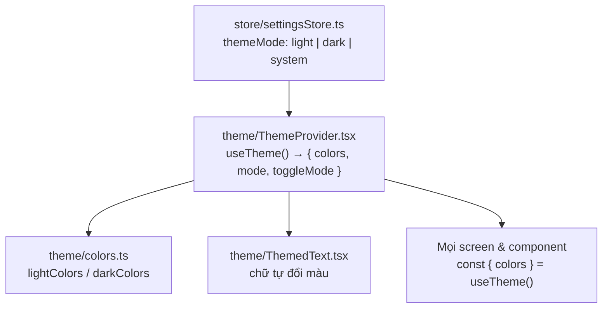

- `ThemeProvider.tsx`: đọc `themeMode` từ `settingsStore`; nếu là `'system'` thì hỏi
  `useColorScheme()` của hệ điều hành, ngược lại dùng thẳng `'light'`/`'dark'`.
  Bơm màu qua `useTheme()`.
- `colors.ts`: hai bảng màu `lightColors` / `darkColors` cùng một kiểu `ThemeColors`.
  Thêm `cameraColors` — **cố định không đổi theo theme** vì màn camera luôn nền tối.
- `typography.ts`: cỡ chữ + font, tất cả đi qua `ms()` (§6.12).
- `ThemedText.tsx`: component `<Text>` tự lấy màu + cỡ theo theme, giới hạn
  `maxFontSizeMultiplier={1.2}` để chữ không phình quá to khi người dùng tăng cỡ chữ máy.
- **Nếu bỏ ThemeProvider:** phải quay lại cách cũ — mỗi component tự `useColorScheme()`
  và tự định nghĩa màu; sửa 1 màu phải sửa hàng chục file.

> **Lưu ý còn tồn:** `app.json` vẫn để `"userInterfaceStyle": "light"`. Muốn app **theo
> đúng theme hệ thống** (khi chọn chế độ "system") cần đổi thành `"automatic"` và thêm
> plugin `expo-system-ui`. Đây là việc **chưa làm**, ghi lại để biết.

### 6.12 `mobile/src/constants/` — Ngôn ngữ & câu chữ

**`languages.ts`** — nguồn chân lý duy nhất về ngôn ngữ:

```ts
export const LANGUAGE_CATALOG = [ /* 11 ngôn ngữ, mỗi mục có: */
  { code: 'vi', shortLabel: 'Tiếng Việt', fullLabel: 'Tiếng Việt (Vietnamese)',
    supportsVoiceInput: true, supportsOcr: true, supportsTts: true, ... },
  /* en, zh, ja, ko, fr, de, es, pt, ru, it */
];
export const SOURCE_LANGUAGES = LANGUAGE_CATALOG;         // 11 lựa chọn cho "Dịch từ"
export const TARGET_LANGUAGES = LANGUAGE_CATALOG;         // 11 lựa chọn cho "Dịch sang"
export const DEFAULT_SOURCE_CODE = 'vi';                  // mặc định khi mở app
export const DEFAULT_TARGET_CODE = 'en';
export function supportsSpeechToText(code): boolean { ... }  // chỉ 'vi' → true
export function supportsOcr(code): boolean { ... }           // vi/en/ja/zh
export function supportsTts(code): boolean { ... }           // cả 11
```

- **11 ngôn ngữ = 11 ngôn ngữ backend hỗ trợ** (`vi, en, zh, ja, ko, fr, de, es, pt, ru, it`).
  Nguồn xác nhận: `docs/language-support.md`.
- Ba hàm `supportsXxx()` là **công tắc dùng chung**: UI ẩn nút, Store chặn hành động —
  tất cả đọc từ **cùng một chỗ**. Thêm khả năng cho 1 ngôn ngữ = sửa **một dòng** ở đây.
- `DEFAULT_SOURCE_CODE` / `DEFAULT_TARGET_CODE` thay cho các chuỗi `'vi'`/`'en'` rải rác
  trước đây (ở `api.ts`, `stream.ts`, `translationStore.ts`, `VoiceListeningScreen.tsx`).
- Kiểu `LanguageCode`, `TargetLanguageCode` sinh ra từ catalog; alias cũ
  `OldLanguageCode` / `TargetLanguageCode` được đánh dấu `@deprecated` nhưng giữ để
  **không phá vỡ import cũ**.

**`strings.ts`** — **toàn bộ câu chữ tiếng Việt** gom một chỗ:
```ts
export const strings = {
  home: { sourceLabel: 'Dịch từ', targetLabel: 'Dịch sang', translateButton: 'Dịch', ... },
  voice: { micHint: (names) => `Micro chỉ hỗ trợ ${names}`, ... },  // hàm nhận tham số
  ...
};
```
- Một số chuỗi là **hàm** (ví dụ gợi ý tên ngôn ngữ hỗ trợ) để ghép tên động từ catalog
  thay vì viết cứng — thêm ngôn ngữ mới thì câu chữ tự cập nhật.
- **Nếu bỏ:** chữ tiếng Việt rải khắp component, đổi 1 câu phải mò nhiều file.

### 6.13 `mobile/src/store/settingsStore.ts` — Cài đặt lưu bền (93 dòng)

Store nhỏ, nhưng là chỗ **duy nhất ghi nhớ cài đặt qua các lần mở app**.

```ts
interface SettingsState {
  defaultSourceLang: LanguageCode;   // "Dịch từ" mặc định, nhớ mãi
  themeMode: 'light' | 'dark' | 'system';
  hasHydrated: boolean;              // đã đọc xong từ bộ nhớ chưa
  setDefaultSourceLang, setThemeMode,
}
const PERSIST_VERSION = 1;           // tăng khi đổi cấu trúc dữ liệu lưu
```

- Dùng middleware `persist` của Zustand + `createJSONStorage(AsyncStorage)` để **tự động
  ghi xuống bộ nhớ điện thoại** mỗi lần giá trị đổi.
- Chỉ 2 trường `defaultSourceLang` + `themeMode` được ghi (kiểu `PersistedSettings`).
  `hasHydrated` **không** ghi — nó là cờ tạm thời.
- `onRehydrateStorage` bật `hasHydrated = true` sau khi đọc xong → UI biết lúc nào đã
  sẵn sàng, tránh nháy sai ngôn ngữ lúc mở app.
- `migrate` + `PERSIST_VERSION`: nếu sau này đổi cấu trúc (ví dụ thêm trường), tăng số
  version lên để chuyển đổi dữ liệu cũ thay vì làm hỏng nó.
- **Nếu bỏ file này:** mỗi lần mở app lại quay về mặc định cứng và không nhớ theme.

### 6.14 `mobile/src/hooks/` — Hai hook giao diện

**`useSpeech.ts` (163 dòng)** — gói toàn bộ logic đọc to (TTS) cho thẻ kết quả:
```ts
export function useSpeech(text, language, enabled) {
  // trả về: { status, ttsError, play, stop }
  //   status: 'idle' | 'loading' | 'playing' | 'error'
}
```
- `play()` gọi `apiSynthesizeSpeech(...)` → nhận base64 → `saveBase64Audio()` ghi file →
  phát bằng `expo-av`.
- **Chốt TTS bằng `supportsTts(language)`**: nếu ngôn ngữ đích không hỗ trợ, hook không
  làm gì, tránh gọi API chắc chắn lỗi.
- `enabled` (thường = `phase === 'result'`) để hook **không chạy khi chưa có kết quả**.
- **Nếu bỏ:** mỗi màn hình hiển thị kết quả phải tự viết lại logic phát/dừng audio.

**`useVoiceRecording.ts` (80 dòng)** — chế độ "ghi rồi nhận dạng":
```ts
export function useVoiceRecording() { /* { start, stop, cancel } */ }
```
- `start()` xin quyền micro rồi bắt đầu ghi bằng `expo-av`.
- `stop()` dừng và trả về đường dẫn file (hoặc `null`).
- `cancel()` dừng và **bỏ kết quả** — dùng khi người dùng rời màn giữa chừng.
- Đây là chế độ dùng được trong **Expo Go** (không cần module native như live audio).

### 6.15 `mobile/src/utils/` — Hai tiện ích nền

**`scale.ts` (72 dòng)** — quy ước co giãn kích thước, **bắt buộc** cho mọi StyleSheet:
```ts
const BASE_WIDTH = 411;   // dp màn chuẩn (Pixel 6)
const BASE_HEIGHT = 890;
s(size)   // co theo chiều NGANG — dùng cho: chiều rộng, padding ngang, borderRadius
vs(size)  // co theo chiều DỌC   — dùng cho: chiều cao khối lớn, khoảng cách dọc
ms(size)  // co VỪA MỪA          — dùng cho: cỡ chữ, lineHeight, icon
```
- Hệ số co giãn bị **kẹp trong [0.8, 1.3]** để giao diện không quá nhỏ trên máy bé hay
  quá to trên tablet; kết quả làm tròn bằng `PixelRatio.roundToNearestPixel`.
- **Quy tắc bắt buộc (theo `CODING_STANDARDS.md`):** không viết số cứng cho kích thước
  trong StyleSheet (trừ độ dày viền `1`/`StyleSheet.hairlineWidth` và `0`).
- Kiểm tra tay trên nhiều máy: xem `mobile/MANUAL_QA.md`.

**`buildContext.ts` (60 dòng)** — ghép giọng văn + ghi chú thành `context` cho backend:
```ts
buildContext(['formal'], '')          // → { context: 'Giọng văn: Trang trọng', contextPreset: 'Formal' }
buildContext(['formal','business'], 'gửi cho khách hàng')
// → { context: 'Giọng văn: Trang trọng, Kinh doanh. Ghi chú: gửi cho khách hàng' }
```
- `PRESET_MAP` chỉ ánh xạ `contextPreset` khi người dùng chọn **đúng 1 tone** — backend
  chỉ hiểu preset cho trường hợp đơn.
- Chọn nhiều tone hoặc có ghi chú → gộp thành chuỗi `context` tự do.
- **Nếu bỏ:** logic ghép ngữ cảnh nằm rải trong store, khó kiểm thử.

---

## 7. Scripts, cấu hình, kiểm thử

### 7.1 `backend/scripts/start_tunnel_and_server.py` — Người điều phối (337 dòng)

Đây là "nút bấm khởi động toàn hệ thống". Nó làm 6 việc theo thứ tự:

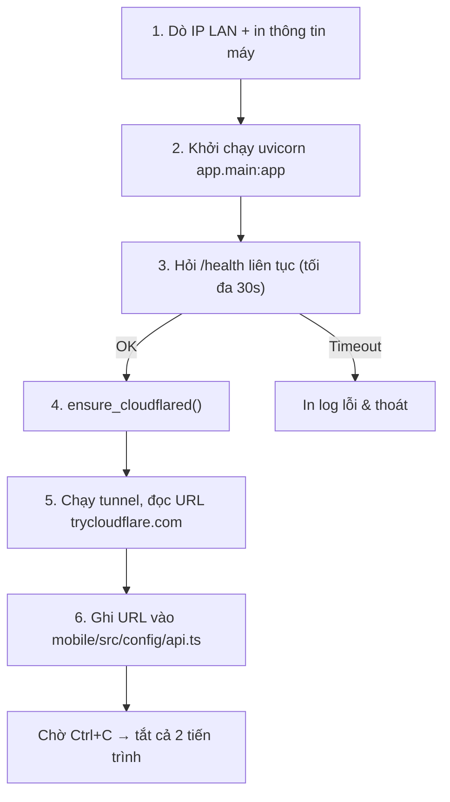

**Chi tiết hay:**

**a) `get_cloudflared_download_info()` — chọn bản theo hệ điều hành:**
```python
if sys.platform.startswith("win"):   return (..., "cloudflared.exe")
elif sys.platform.startswith("darwin"):  # macOS: arm64 hay amd64
else:  # Linux / Colab
```
Đáp ứng yêu cầu "Cross-Platform Portability" trong CODING_STANDARDS.md (mục C).

**b) Drain thread — chống deadlock ống dẫn trên Windows:**
```python
threading.Thread(target=_drain_stream, args=(server_proc.stdout, server_logs), daemon=True).start()
```
- **Vấn đề:** trên Windows, buffer của pipe chỉ 4 KB. Nếu tiến trình con in log mà
  không ai đọc, buffer đầy → tiến trình con **treo cứng**.
- **Giải pháp:** luôn có luồng nền đọc và vứt log đi. Cực kỳ dễ bỏ sót khi dev trên Linux.

**c) `update_mobile_config()` — "điểm tự cấu hình" của dự án:**
```python
ws_url = base_url.replace("http://","ws://").replace("https://","wss://")
content = f"""// Auto-generated by start_tunnel_and_server.py
export const API_BASE_URL = '{base_url}';
export const WS_BASE_URL = '{ws_url}/ws/stream';"""
target.write_text(content)
```
- Mỗi lần chạy, tunnel đổi URL → script **tự viết lại** file config mobile. Người dùng
  chỉ cần chạy Expo là xong, không phải copy-paste URL.
- **Nếu bỏ:** mỗi lần đổi tunnel phải sửa tay `api.ts` — phiền và dễ quên.

**d) `finally`/`KeyboardInterrupt`:** `Ctrl+C` → `terminate()` cả tunnel lẫn server.
Không có: tiến trình cloudflared "mồ côi" vẫn chạy nền.

### 7.2 `backend/scripts/download_models.py` — Tải model (169 dòng)

Ba hàm, ba nguồn model:
- `download_phoasr()` → `snapshot_download` cả repo HuggingFace vào `models/phoasr`.
- `download_gemma_gguf()` → `hf_hub_download` **một file** `.gguf` (~2.8 GB). Có
  **kiểm tra file tồn tại + lớn hơn 100 MB** để không tải lại.
- `download_pocket_tts()` → gọi `TTSModel.load_model(language=...)` — trick: hàm này
  tự tải cache nếu chưa có, nên "gọi load" = "tải".

Có cờ `--skip-gemma`, `--skip-phoasr`, `--skip-tts`, `--tts-languages` — cài linh hoạt.

### 7.3 `backend/scripts/smoke_test.py` (185 dòng) & `ws_test.py` (145 dòng)

- **`smoke_test.py`**: chỉ dùng thư viện chuẩn Python. Kiểm tra `/health`, `/metrics`,
  dịch, TTS, ASR, và **2 request dịch đồng thời**. In `[PASS]/[FAIL]` và mã thoát.
  Dùng khi server đã chạy — "bấm phát biết sống chết".
- **`ws_test.py`**: gửi 1 file WAV 16 kHz vào `/ws/stream` và in mọi sự kiện. Có cờ
  `--odd` (gửi gói lẻ byte để test `pending_byte`) và `--fast` (không chờ thời gian thực).

### 7.4 `scripts/check.py` — Cửa gác chất lượng (42 dòng)

```python
res = subprocess.run([sys.executable, "-m", "ruff", "check", "backend"], cwd=APP_ROOT)
if "--tests" in sys.argv:
    subprocess.run([sys.executable, "-m", "pytest", "backend/tests", "-m", "not slow"], ...)
```
Chạy linter Ruff; thêm `--tests` thì chạy thêm test nhanh. Dòng
`sys.stdout.reconfigure(encoding="utf-8")` sửa lỗi hiển thị tiếng Việt trên console Windows.

### 7.5 `scripts/setup-wizard.sh` — Trợ lý cài đặt 6 bước

Phần trên (tới dòng ~193) là **thư viện chung** (hàm hiển thị, hỏi/đáp, ghi `.env`).
Phần dưới là 6 "stage" thật:

| Stage | Nội dung |
| :--- | :--- |
| 1 | Dò GPU (`nvidia-smi`), chọn `DEVICE` |
| 2 | Kiểm tra file GGUF, chọn context window, số layer GPU |
| 3 | Cổng server, giới hạn thời lượng audio |
| 4 | Bật/tắt Cloudflare Tunnel |
| 5 | Hướng dẫn cài Expo |
| 6 | Chốt lại lệnh khởi động |

Hàm `write_env KEY VALUE **upsert**` — ghi đè dòng cũ thay vì thêm mới, nên chạy
wizard nhiều lần không tạo `.env` trùng lặp.

### 7.6 `pyproject.toml` — Cấu hình công cụ

```toml
[tool.ruff]
line-length = 110
[tool.ruff.lint]
select = ["E","F","I","UP","B"]     # lỗi chuẩn, import chưa dùng, isort, cú pháp mới
ignore = ["E501","B008"]
[tool.pytest.ini_options]
testpaths = ["backend/tests"]
pythonpath = ["backend"]
markers = ["slow", "integration", "unit"]
```
- `ignore = ["B008"]` là cần thiết: FastAPI dùng `Depends()` trong giá trị mặc định của
  tham số — bugbear tưởng đó là lỗi nhưng nó là pattern chuẩn của FastAPI.
- Marker `slow` cho phép chạy test nhanh bằng `-m "not slow"`.

### 7.7 `backend/tests/` — 10 file test

| File | Kiểm tra gì | Loại |
| :--- | :--- | :--- |
| `test_health_and_models.py` | `/health`, `/docs`, CORS, singleton manager, VRAM | Unit |
| `test_translation_adapter.py` | Preset ngữ cảnh, prompt template, lỗi khi chưa load | Unit |
| `test_translation_api.py` | `/api/translate` đủ trường hợp + tương thích ngược | Integration |
| `test_asr_api.py` | `/api/asr`: file hợp lệ, sai đuôi 415, rỗng/im/corrupt/31s → 422 | Integration |
| `test_ocr_adapter.py` | `detect_language()` cho vi/en/ja/zh + trích text ảnh | Unit |
| `test_ocr_api.py` | `/api/ocr` 2 giai đoạn, ảnh trắng, sai đuôi, ảnh hỏng | Integration |
| `test_tts_api.py` | TTS en/vi, nhái giọng, JSON body, giới hạn 20 MB, VRAM = 0 | Integration |
| `test_stream_websocket.py` | **6 kịch bản VAD khó**: byte lẻ, 10 s im lặng, 2 câu theo thứ tự, câu chậm không nghẽn, stop giữa câu, JSON méo | Integration |
| `test_inference_serialization.py` | **Khoá `_lock`** chặn 2 suy luận song song (cả 3 adapter) | Unit |
| `test_tunnel_and_launcher.py` | Trích URL tunnel, sinh config mobile, giải nén `.tgz` macOS | Unit |

**Hai file test đáng chú ý nhất:**

- `test_inference_serialization.py` — dùng `threading.Event` để "đứng hình" thread 1
  ở giữa suy luận, rồi khẳng định thread 2 **chưa vào**. Đây là cách test concurrency
  không cần GPU thật.
- `test_stream_websocket.py` — tạo `FakeManager` bằng `MagicMock` rồi **thay hẳn**
  `stream_mod.get_model_manager`. Test chạy không cần GPU, không cần model. Ví dụ mẫu
  mực về cách "vá" dependency để test.

---

## 8. "Nếu bỏ thì sao?"

Bảng tổng hợp **các dòng/thành phần then chốt** — bỏ đi thì hệ thống hỏng thế nào.
Cột cuối ghi mức độ ưu tiên gỡ khi refactor.

| Thành phần | File | Bỏ đi thì sao? | Ưu tiên |
| :--- | :--- | :--- | :--- |
| `manager.startup()` | `main.py` | Server sống nhưng mọi request lỗi "model not loaded" | 🔴 Không gỡ |
| `run_in_executor(...)` | mọi route | Suy luận đồng bộ đóng băng event loop → server treo khi đang dịch | 🔴 Không gỡ |
| `self._lock` trong adapter | `*_adapter.py` | 2 suy luận song song → tràn VRAM / kết quả rác | 🔴 Không gỡ |
| Singleton `get_model_manager()` | `manager.py` | Mỗi request load lại model 4B → cạn VRAM | 🔴 Không gỡ |
| `_resolve_effective_device()` | `config.py` | GPU cũ (CC<7.5) crash lỗi CUDA khó hiểu lúc inference | 🟠 Giữ |
| `job_queue` + `_utterance_worker` | `stream.py` | Âm thanh client mất trong lúc model đang xử lý câu trước | 🔴 Không gỡ |
| `ring_buffer` (300 ms) | `stream.py` | Mất âm đầu câu → ASR sai chữ đầu | 🟠 Giữ |
| `pending_byte` (byte lẻ) | `stream.py` | Crash ngẫu nhiên khi WiFi chèn gói lẻ byte | 🟠 Giữ |
| `VADSettings` (hằng tập trung) | `stream.py` | Con số rải rác, sửa 1 quên 5 (vi phạm standard) | 🟡 Nên giữ |
| `sessionId` chống trộn phiên | `translationStore.ts` | Chữ phiên cũ nhảy vào phiên mới | 🟠 Giữ |
| `swapLanguages` + chặn nguồn=đích | `translationStore.ts` | Chọn trùng ngôn ngữ → dịch vô nghĩa, phá STT/TTS | 🟠 Giữ |
| `supportsSpeechToText/Ocr/Tts` | `constants/languages.ts` | UI hiện nút chắc chắn lỗi; người dùng nhận thông báo khó hiểu | 🟠 Giữ |
| `ThemeProvider` + `useTheme()` | `theme/ThemeProvider.tsx` | Mỗi component tự `useColorScheme()` → lặp code, khó đổi màu | 🟠 Giữ |
| `hasHydrated` + `migrate` | `settingsStore.ts` | Đọc bộ nhớ chưa xong đã vẽ UI → nháy sai ngôn ngữ lúc mở | 🟡 Nên giữ |
| `captureGeneration` | `liveAudio.ts` | Micro có thể bật lén sau khi người dùng huỷ | 🟠 Giữ |
| `AppState` cleanup | `HomeScreen.tsx` / `VoiceListeningScreen.tsx` | Rời app vẫn thu micro → tốn pin, rò rỉ riêng tư | 🟠 Giữ |
| `api_key_middleware` | `main.py` | Ai biết URL cũng dùng được GPU của bạn | 🔴 Bật khi production |
| `update_mobile_config()` | `start_tunnel_and_server.py` | Mỗi lần đổi tunnel phải sửa tay `api.ts` | 🟡 Tiện ích |
| `drain_thread` | `start_tunnel_and_server.py` | Trên Windows: tiến trình con treo vì pipe đầy 4 KB | 🟠 Giữ (nếu dùng Windows) |
| `is_silent` check | `asr_adapter.py` | Audio im lặng → Whisper "bịa" chữ (hallucination) | 🟡 Nên giữ |
| `vietnamese_text` (legacy) | `schemas/ocr.py` | App mobile phiên bản cũ vỡ response | 🟡 Chỉ gỡ khi bỏ client cũ |
| `detect_language()` thứ tự S→J→Z | `ocr_adapter.py` | Đảo thứ tự → tiếng Nhật bị nhận sai thành Trung | 🟠 Giữ |
| `temperature=0.3` | `translation_adapter.py` | Tăng lên cao → bản dịch "phóng tác", kém chính xác | 🟠 Giữ thấp |
| `stop=["<end_of_turn>", ...]` | `translation_adapter.py` | Model sinh thêm lời bình luận thừa sau bản dịch | 🟠 Giữ |
| `finally: set({isXxx:false})` | `translationStore.ts` | Spinner quay mãi khi lỗi; nút kẹt disabled | 🔴 Không gỡ |
| Dọn file TTS cũ | `services/api.ts` | Cache điện thoại đầy dần sau nhiều lần dịch | 🟡 Nên giữ |

### Nợ kỹ thuật đã biết (nên cải thiện)

| Vấn đề | Vị trí | Gợi ý |
| :--- | :--- | :--- |
| Hardcode path `d:/APP test/...` | `translation_adapter.py:_resolve_model_path` | Xoá, chỉ dùng `settings.GEMMA_GGUF_PATH` |
| `allow_origins=["*"]` | `main.py` CORS | Siết thành danh sách URL cụ thể khi production |
| `"userInterfaceStyle": "light"` | `mobile/app.json` | Đổi `"automatic"` + thêm `expo-system-ui` để theo theme hệ thống |
| Tên file/màn còn chữ "V1" | `screens/*` (legacy) | Dọn hẳn các file V1 không dùng khi không cần tham khảo nữa |
| Phiên bản trong `requirements.txt` rất cao | `requirements.txt` | Kiểm tra lại tính khả dụng khi cài thật |

---

## 9. Cách chạy dự án

### 9.1 Chuẩn bị (một lần)

```bash
# 1. Cài thư viện Python
cd Translation-App/backend
python -m venv venv
# Windows:  venv\Scripts\activate
# Linux/mac: source venv/bin/activate
pip install -r requirements.txt

# 2. Tải model (GGUF ~2.8GB + PhoASR + Pocket TTS)
python scripts/download_models.py --tts-languages english

# 3. Tạo file cấu hình
cp backend/.env.example backend/.env    # rồi sửa GEMMA_GGUF_PATH nếu cần

# 4. Cài thư viện mobile
cd ../mobile
npm install
```

### 9.2 Khởi động (mỗi lần làm việc)

```bash
# Terminal 1 — backend + tunnel (tự cập nhật URL cho mobile)
cd Translation-App
python backend/scripts/start_tunnel_and_server.py
#   → in ra URL trycloudflare + cập nhật mobile/src/config/api.ts
#   → (nếu chỉ test trong LAN: thêm --local-only)

# Terminal 2 — app điện thoại
cd Translation-App/mobile
npx expo start
#   → quét QR bằng Expo Go (Android) hoặc Camera (iOS)
```

> **Lưu ý:** tính năng **Live Mic Stream** cần development build (`npx expo run:android`)
> vì dùng module native `react-native-live-audio-stream`. Các tính năng khác chạy được
> trong Expo Go.

### 9.3 Kiểm tra chất lượng

```bash
cd Translation-App
python scripts/check.py            # linter
python scripts/check.py --tests    # linter + test nhanh
python -m pytest backend/tests -m "not slow"
cd mobile && npm run typecheck
```

### 9.4 Ai nên đọc gì trước?

| Bạn là... | Đọc theo thứ tự |
| :--- | :--- |
| **Người mới hoàn toàn** | §1 → §2 → §4.1 → file `routes/translate.py` → `models/translation_adapter.py` |
| **Muốn hiểu real-time** | §4.4 → `routes/stream.py` (đọc từ dưới lên: endpoint → worker → helpers) → `services/stream.ts` |
| **Muốn sửa giao diện** | §6.7 → `translationStore.ts` → `HomeScreen.tsx` → `theme/` → component cần sửa |
| **Muốn tối ưu model** | §5.1 → `config.py` → `models/manager.py` → adapter tương ứng |
| **Muốn triển khai** | §7.1 (launcher) → §8 (bảo mật API key, CORS) |

---

## 10. FAQ

**Q: Tại sao phải chạy Cloudflare Tunnel? Điện thoại cùng WiFi mà?**
A: Không bắt buộc. Dùng `--local-only` để test trong LAN. Tunnel cần khi bạn muốn
dùng 4G (ngoài nhà) — nó tạo URL HTTPS công khai mà không cần mở port router.

**Q: Tôi chạy macOS/Linux nhưng `start_tunnel_and_server.py` không thấy cloudflared?**
A: Script tự tải binary vào `../tools/` (hoặc `tools/`). Trên macOS bản `.tgz` được
giải nén tự động. Nếu mạng công ty chặn GitHub, `ensure_cloudflared()` trả `None` và
script tự chuyển về chế độ LAN.

**Q: `/health` báo `device: "cpu"` nhưng tôi có GPU?**
A: Xem `_resolve_effective_device()` ở §5.1. GPU của bạn có thể có Compute Capability
< 7.5 → PyTorch không hỗ trợ. Đây là hành vi **cố ý** để tránh crash lúc inference.

**Q: Vì sao TTS tiếng Việt không nhái được giọng?**
A: Pocket TTS (engine local) không có checkpoint tiếng Việt. Hệ thống tự chuyển sang
Edge-TTS (cloud Microsoft). Đây là đánh đổi công khai, ghi trong README §Security.

**Q: Vì sao test trong `test_stream_websocket.py` không cần GPU?**
A: Vì dùng `MagicMock` làm giả ModelManager + adapter, rồi gán đè
`stream_mod.get_model_manager`. Xem §7.7.

**Q: `run_in_executor` là gì? Tại sao dùng nhiều thế?**
A: Là cách chạy code đồng bộ (blocking) trong thread riêng, không chặn event loop
async. Suy luận model là blocking → bắt buộc dùng, nếu không server "đóng băng".

**Q: Thêm 1 ngôn ngữ dịch mới (ví dụ Thái) thì làm gì?**
A: 1) Thêm một mục vào `LANGUAGE_CATALOG` ở `mobile/src/constants/languages.ts`
(đặt cờ `supportsVoiceInput`/`supportsOcr`/`supportsTts` cho phù hợp); 2) Thêm tên vào
`LANGUAGE_NAMES` ở `translation_adapter.py`; 3) Nếu muốn đọc to, thêm giọng vào
`EDGE_VOICES_FEMALE/MALE` ở `tts_adapter.py`. Model dịch (TranslateGemma) đã hỗ trợ
nhiều ngôn ngữ sẵn — chỉ cần khai báo. Nguồn xác nhận khả năng: `docs/language-support.md`.

**Q: Vì sao có `metrics.py` mà không thấy app dùng?**
A: Đây là endpoint **quan sát/demo**, dùng qua `/docs` hoặc `smoke_test.py --base ...`
để xem VRAM + độ trễ khi thuyết trình. App mobile không gọi nó.

**Q: Làm sao chắc chắn mọi thứ chạy sau khi cài?**
A: `python backend/scripts/smoke_test.py --base http://localhost:8000`. Nó in
`[PASS]/[FAIL]` cho từng chức năng kèm thời gian — phù hợp để dán nguyên output khi
cần người khác hỗ trợ.

---

## Phụ lục A — Bảng tra thuật ngữ

| Thuật ngữ | Nghĩa dễ hiểu |
| :--- | :--- |
| **ASR** (Automatic Speech Recognition) | Nghe giọng nói → chữ |
| **TTS** (Text-to-Speech) | Chữ → giọng nói |
| **OCR** | Chữ trong ảnh → chữ kỹ thuật số |
| **VAD** (Voice Activity Detection) | Tự phát hiện khi nào có người nói |
| **RMS** (Root Mean Square) | Số đo độ "to" của âm thanh |
| **VRAM** | Bộ nhớ trên card đồ họa (GPU) |
| **GGUF** | Định dạng file model nén cho `llama.cpp` |
| **Quantization (lượng tử hoá)** | Nén model nhỏ hơn (Q5_K_M ≈ 5-bit) |
| **Prompt** | Câu lệnh/ngữ cảnh cho model LLM |
| **Token** | Mảnh chữ nhỏ — đơn vị LLM sinh ra từng cái một |
| **Streaming** | Trả kết quả dần dần thay vì chờ hết |
| **WebSocket** | Kênh kết nối 2 chiều, giữ mở liên tục |
| **REST** | Kiểu gọi API "hỏi-đáp" qua HTTP |
| **Singleton** | Chỉ tồn tại đúng 1 bản trong bộ nhớ |
| **Adapter** | Lớp bọc, che giấu chi tiết bên trong |
| **Multipart** | Định dạng gửi file qua HTTP |
| **base64** | Cách mã hoá dữ liệu nhị phân thành chữ |
| **Thread / Lock** | Luồng chạy song song / khoá chống tranh chấp |
| **Event loop** | Vòng lặp xử lý sự kiện của async Python |
| **Blocking** | Code chiếm CPU tới khi xong, chặn mọi thứ khác |
| **Tunnel** | Kênh proxy đưa server local ra Internet |

---

## Phụ lục B — Sơ đồ "ai gọi ai" (ma trận phụ thuộc)

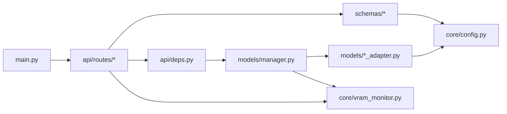

Bảng "ai import ai" rút gọn:

| File | Import từ |
| :--- | :--- |
| `main.py` | routes, config, vram_monitor, manager, schemas |
| `routes/*.py` | deps, schemas, vram_monitor, manager |
| `models/manager.py` | config, 4 adapter |
| `models/*_adapter.py` | config (một số ít), torch, thư viện AI |
| `core/config.py` | torch (chỉ để kiểm tra CUDA) |
| `core/vram_monitor.py` | torch |
| `schemas/*.py` | pydantic |
| Mobile `store` | `services/api`, `services/stream`, `services/liveAudio`, `constants/languages`, `constants/strings`, `utils/buildContext` |
| Mobile `settingsStore` | `store/settingsStore` |
| Mobile `theme/ThemeProvider` | `theme/colors`, `store/settingsStore` |
| Mobile `screens/*` | `store/translationStore`, `theme/ThemeProvider`, `components/*`, `constants/strings` |
| Mobile `services/stream` | `services/api` (lấy URL) |
| Mobile `services/api` | `config/api`, `constants/languages` |

**Nguyên tắc:** mũi tên chỉ đi **một chiều** từ ngoài vào trong
(main → routes → manager → adapters → core). Không có chiều ngược.
Đây là kiến trúc "layered" — đổi adapter không ảnh hưởng route; đổi route không
ảnh hưởng model.

---

## Phụ lục C — Trình tự đọc code đề xuất (cho người mới)

1. `README.md` — biết hệ thống làm gì
2. `giai_thich.md` §1, §2 — bức tranh lớn (tài liệu này)
3. `backend/app/core/config.py` — các "núm vặn" của hệ thống
4. `backend/app/api/routes/translate.py` — mẫu route đơn giản nhất (75 dòng)
5. `backend/app/models/translation_adapter.py` — hiểu adapter + prompt + lock
6. `backend/app/main.py` — ghép mọi thứ lại
7. `backend/app/api/routes/stream.py` — phần khó nhất (đọc khi đã quen)
8. `mobile/src/store/translationStore.ts` — não bộ mobile
9. `mobile/src/screens/HomeScreen.tsx` — giao diện V2 (đọc các màn phụ ở §6.9 sau)
10. `backend/tests/` — xem hệ thống được kiểm tra thế nào

---

*Tài liệu sinh ra từ việc đọc trực tiếp toàn bộ mã nguồn trong
`Translation-App/` (backend, mobile, scripts, tests).*
